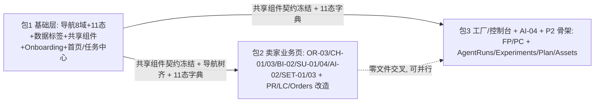

# FRONTEND V9 · 蓝图 R1 文件级实施任务分解

> 上游依据：`docs/FRONTEND_V9_BLUEPRINT_R1_GAP_ANALYSIS.md`（差距分析，§1–§7）
> 蓝图原文：《AI原生跨境电商经营平台 V9.0 全站前端产品与交互详细蓝图（评审稿）》V9.0-UX-Blueprint-R1
> 现状基线：`frontend-v9/`（35 页面 / 295 测试全通过）
> 本文性质：**文件级任务分解（可执行工程师任务包）**。所有路径相对 `frontend-v9/`。
> 硬约束：不新增冲突 path（现有 path 全部保留，302/深链/测试可回归）；"待接入"页一律只读骨架，禁止假按钮/假数据/假成功态。

---

## 0. 现状关键文件速查（本分解涉及的既有路径）

| 类别 | 路径（相对 `frontend-v9/`） |
|---|---|
| 路由表 | `src/app/router/index.js`、`routes-uxd.js`、`routes-uxe-a.js`、`routes-uxe-b.js` |
| 导航树 | `src/shared/navigation/workspace-navigation.js`（11 域）、`console-navigation.js`、`factory-navigation.js`、`types.js`、`filter.js` |
| 角色/守卫 | `src/permissions/permissions.js`（ROLES / routeRedirect / defaultLanding） |
| Workspace 层 | `src/shared/workspace.js`（switchWorkspace / loadWorkspaces / subscribeWorkspaceChange） |
| 壳 | `src/shells/WorkspaceShell.vue`（待装配 TaskCenter 注释位）、`composables/workspaceShell.js` |
| 共享组件 | `src/components/`（21 个：SectionState / StatusBadge / EmptyState / ErrorState / LoadingState / WorkspaceSwitcher / StoreSwitcher / EvidencePanel / TaskCard / MetricCard / PageHeader / DataTable / AdvancedFilter / ApprovalPanel / AiActionCard / ConfirmDialog / …） |
| API 域 | `src/api/domains/`（auth/me/workbench/launch/actions/discovery/products/orders/purchases/refunds/settlements/suppliers/support/pricing/ads/alerts/finance/bi/listings/admin/factoryNetwork/shops/schedules/workflows/knowledge/ai/users …） |
| 字典 | `src/shared/statusDict.js`（5~6 态）、`src/shared/biCaliber.js`（BI 口径） |
| 测试 | `tests/*.test.js`（纯函数/纯模块风格，无 @vue/test-utils） |

**关键结论**：本项目未装 `@vue/test-utils`，测试只覆盖纯函数/纯模块。所有 `.vue` 组件逻辑须下沉到纯函数/纯模块（如字典、状态机、深链构造）后再写测试。组件本身用人工/契约核对。

---

## A. 导航重组 spec（P0）

### A.1 现有 11 域 → 蓝图 R1 8 域的具体 label/path 映射

> 原则：**path 全部不变**（302 查表、深链、295 测试零影响）；只改 `workspace-navigation.js` 的域 key/label/分组 + `meta.domain` 标签 + `filter.js` 白名单枚举 + 新手抑制。
> Settings 下沉：主导航不占 8 域名额；路由与 `requiresOwner` 守卫保留；`/app/settings/ai`、`/app/settings/team` 路由不动。

| # | 旧域 key | 旧 label | 新域 key | 新 label | 新域内 items（★=新增子项，path 不变/新增） |
|---|---|---|---|---|---|
| 1 | `home` | 首页 | `workbench` | 工作台 | `/app` 经营首页；★ `/app/tasks` 我的待办（WK-02，新增） |
| 2 | `market` | 市场机会 | `discovery` | 发现与商品 | `/app/market/discovery` 市场机会；★ `/app/market/candidates` 商品候选池（MK-03，新增） |
| 3 | `product`（部分） | 商品经营 | `discovery`（并入） | 发现与商品 | `/app/products` 商品库；`/app/listings` Listing 工作台；`/app/launch` 上线中心 |
| 4 | `product`（合规/素材） | 商品经营 | `discovery`（并入） | 发现与商品 | `/app/compliance` 合规报告；`/app/compliance/approvals` 合规工作台；★ `/app/products/assets` 素材中心（AS-01，新增） |
| 5 | `supply` | 货源中心 | `supply` | 货源与采购 | ★ `/app/supply/sourcing` 货源发现（SU-01）；`/app/supply/suppliers` 供应商库；★ `/app/supply/matching` 货源匹配（SU-04）；`/app/supply/purchases` 采购单 |
| 6 | `optimization`（risk/alerts） | 经营优化 | `optimize` | 经营优化 | `/app/risk/alerts` 供应风险/商品与店铺诊断（专业入口，label 改"商品与店铺诊断"，path 不变；**归 optimize 域，supply 域不再重复挂**） |
| 7 | `channel` | 销售渠道 | `channel` | 渠道与店铺 | ★ `/app/channels` 渠道推荐（CH-01，新增）；`/app/channels/shops` 店铺管理 |
| 8 | `fulfill` + `aftersale` | 订单履约/客户售后 | `orders` | 订单与服务 | `/app/orders` 订单工作台；★ `/app/fulfillment` 发货/代发/备货（OR-03，新增）；`/app/refunds` 售后退款；`/app/support` 客户消息；★ `/app/settlements` 结算与对账（挪入 finance，见 #9） |
| 9 | `analytics` | 数据分析 | `finance` | 财务与分析 | `/app/analytics/bi` 经营总览与 BI；`/app/analytics/finance` 真实利润；`/app/analytics/landed-cost` 到岸成本；★ `/app/analytics/forecast` 预测与数据质量（BI-02，新增）；★ `/app/settlements` 结算与对账（FN-02，path 不变，域归属改 finance） |
| 10 | `optimization`（pricing/ads） | 经营优化 | `optimize` | 经营优化 | `/app/pricing` 定价与利润试算；`/app/ads` 广告与转化；★ `/app/optimization/experiments` 策略实验（OP-04，新增） |
| 11 | `aiops` | AI 运营 | `ai` | AI 与自动化 | ★ `/app/ai/actions` AI 行动中心（AI-02，新增）；`/app/ai/workflows` 工作流；★ `/app/ai/agent-runs` Agent 运行（AI-04，新增，requiresOwner）；`/app/ai/knowledge` 知识库；`/app/ai/decisions` 决策依据（专业入口可收起） |
| — | `settings` | 设置与管理 | 下沉 | 账户菜单 | 主导航**不挂 8 域**；账户菜单=★空间信息(SET-01)/成员权限(`/app/settings/team`)/★凭据(SET-03)/★套餐(SET-04)；`/app/settings/ai`、`/app/settings/team` 路由保留，非 OWNER 仍隐藏 |

> 域 key 变更点（旧 → 新）：`home`→`workbench`、`market`+`product`→`discovery`、`fulfill`+`aftersale`→`orders`、`analytics`→`finance`、`optimization`→`optimize`、`aiops`→`ai`、`channel`/`supply` 保留、`settings` 下沉。
> **面包屑同源**：`meta.domain`（index.js / routes-*.js）中文标签须与新域 label 对齐（如 `domain: '发现与商品'`），改动集中在 routes 数组的 `meta.domain` 字段。

### A.2 需要修改的 navigation.js 文件（3 空间各一份）

| 文件（相对 `frontend-v9/`） | 改动 |
|---|---|
| `src/shared/navigation/workspace-navigation.js` | **主改**：11 域 → 8 域（key/label/icon/children 重排 + 7 个★新增子项 + settings 下沉）；新手域抑制见 A.4 |
| `src/shared/navigation/console-navigation.js` | PC-03/04/05 新增 3 子项（`/console/adapters`、`/console/rules`、`/console/ai-resources`）；PC-02 代客审计字段在 Tenants 页内处理，导航不变 |
| `src/shared/navigation/factory-navigation.js` | FP-01/04/05 处理：`/factory` 首页（重定向）+ `★/factory/stocking`（待接入只读）+ `★/factory/fulfillment`（待接入占位）；现有 `/factory/products` 拆为 `/factory/catalog`+`/factory/capability`（见 E 包 3） |
| `src/shared/navigation/types.js` | `NAV_BADGES` 增加 `'tasks'`（待办计数 = workbench/todo 长度） |
| `src/shared/navigation/filter.js` | COMPLIANCE 白名单按新域重枚举（path 集合语义不变）；`NON_OWNER_HIDDEN_PATHS`/`OWNER_ONLY_PREFIX` 随 settings 下沉复核；新手抑制 `buildDomains` 增 `persona` 参数（见 A.4） |

> **注**：包 1（P0 导航重组）只动 `workspace-navigation.js` + `filter.js` + `types.js`；console/factory 两树的新增子项归包 3（工厂/控制台扩展），避免同一文件跨包。

### A.3 每域子项 path 汇总（导航渲染层可见集合）

**WORKSPACE（8 域 + settings 下沉）——完整叶子 path 集合：**
- workbench：`/app`、`/app/tasks`
- discovery：`/app/market/discovery`、`/app/market/candidates`、`/app/products`、`/app/listings`、`/app/launch`、`/app/compliance`、`/app/compliance/approvals`、`/app/products/assets`
- supply：`/app/supply/sourcing`、`/app/supply/suppliers`、`/app/supply/matching`、`/app/supply/purchases`
- channel：`/app/channels`、`/app/channels/shops`
- orders：`/app/orders`、`/app/fulfillment`、`/app/refunds`、`/app/support`、`/app/settlements`
- optimize：`/app/pricing`、`/app/ads`、`/app/risk/alerts`、`/app/optimization/experiments`
- finance：`/app/analytics/bi`、`/app/analytics/finance`、`/app/analytics/landed-cost`、`/app/analytics/forecast`
- ai：`/app/ai/actions`、`/app/ai/workflows`、`/app/ai/agent-runs`、`/app/ai/knowledge`、`/app/ai/decisions`
- settings（账户菜单，主导航不占名额）：`/app/settings/workspace`★、`/app/settings/team`、`/app/settings/credentials`★、`/app/settings/plan`★、`/app/settings/ai`

**新增 path 白名单（需 routes 表 + filter.js + 302 回归核对）：**
`/app/tasks`、`/app/market/candidates`、`/app/market/opportunity/:id`(hidden)、`/app/products/assets`、`/app/supply/sourcing`、`/app/supply/matching`、`/app/channels`、`/app/channels/shops/:id`(hidden)、`/app/fulfillment`、`/app/optimization/experiments`、`/app/analytics/forecast`、`/app/ai/actions`、`/app/ai/agent-runs`、`/app/settings/workspace`、`/app/settings/credentials`、`/app/settings/plan`、`/factory/stocking`、`/factory/fulfillment`、`/console/adapters`、`/console/rules`、`/console/ai-resources`。
> 302 查表（`index.js legacyRedirectTable`）与新 path **无冲突**（新 path 均为 `/app|/factory|/console` 深层子路径，未被旧查表命中）。

### A.4 新手域抑制 buildDomains 逻辑（差距分析 §4 展开）

蓝图 §2.1 要求：GUIDED 模式仅展开与画像相关的域，PROFESSIONAL 全量展开。落地：

```js
// filter.js buildDomains 增 persona 参数（纯函数，视觉层抑制，不改路由守卫白名单）
// 画像 A(个人新手) → workbench / discovery / channel
// 画像 B(有货源)   → A + supply / orders
// 画像 C(有团队)   → A + orders / ai
// PROFESSIONAL / 未知 persona → 全量 8 域
export function buildDomains({ roleKey, canManageMembers, isImpersonating, persona = '' } = {}) {
  // 1) 角色白名单过滤（既有逻辑不变，服务端双重限制仍然生效）
  const allowed = whitelistForRole({ roleKey, canManageMembers, isImpersonating })
  let domains = filterDomainsByPaths(WORKSPACE_DOMAINS, allowed)
  // 2) 新手域抑制（仅 WORKSPACE 视觉层；PLATFORM_ADMIN/FACTORY 树不适用）
  if (persona) domains = suppressDomainsByPersona(domains, persona)
  return domains
}

// persona → 保留域 key 映射；未知 persona / PROFESSIONAL → 返回全量 domains
const PERSONA_DOMAINS = {
  A: ['workbench', 'discovery', 'channel'],
  B: ['workbench', 'discovery', 'supply', 'channel', 'orders'],
  C: ['workbench', 'discovery', 'channel', 'orders', 'ai'],
}
function suppressDomainsByPersona(domains, persona) {
  const keep = PERSONA_DOMAINS[persona]
  if (!keep) return domains // PROFESSIONAL / 未知 → 全量
  return domains.filter((d) => keep.includes(d.key)) // 配合"常用/全部功能"切换
}
```

- `persona` 来源：`getContext()?.experience_mode`（GUIDED/PROFESSIONAL）+ 新手画像派生；PROFESSIONAL 不传 persona（全量）。
- **安全边界**：抑制仅是**视觉层**，`whitelistForRole` / 路由守卫白名单不变，服务端仍双重限制权限；合规角色过滤仍先于抑制执行。
- 测试：`tests/navigation.test.js` 增 `buildDomains({persona:'A'})` 域数断言（A=3 域、C=5 域、`''`=全量）。

### A.5 导航相关 `meta.domain` 中文标签同步（面包屑）

routes 数组中 `meta.domain` 须随新域 label 调整（仅文本，不影响 302/守卫）：

| path | 旧 `meta.domain` | 新 `meta.domain` |
|---|---|---|
| `/app` | 首页 | 工作台 |
| `/app/market/discovery` | 市场机会 | 发现与商品 |
| `/app/products`、`/app/listings`、`/app/launch`、`/app/compliance*` | 商品经营 | 发现与商品 |
| `/app/supply/*` | 货源中心 | 货源与采购 |
| `/app/channels/shops` | 销售渠道 | 渠道与店铺 |
| `/app/orders`、`/app/settlements` | 订单履约 | 订单与服务 |
| `/app/refunds`、`/app/support` | 客户售后 | 订单与服务 |
| `/app/pricing`、`/app/ads`、`/app/risk/alerts` | 经营优化 | 经营优化 |
| `/app/analytics/*` | 数据分析 | 财务与分析 |
| `/app/ai/*` | AI 运营 | AI 与自动化 |
| `/app/settings/*` | 设置与管理 | 设置与管理（下沉，路由保留） |

---

## B. 新增页面文件清单（P0/P1）

> 每页一行：蓝图 ID / 路由 path / 组件文件完整路径 / 挂载路由文件 / 所需 API 域 / 所需共享组件 / P 级。
> 路径相对 `frontend-v9/`。"API_GAP" = 差距分析 §7 待接入项，需只读骨架 + 明示。
> 路由挂载约定：`appChildren` 内联在 `index.js`；UXD 页走 `routes-uxd.js`；UXE-A console/factory 走 `routes-uxe-a.js`；UXE-B aiops/settings 走 `routes-uxe-b.js`。

### B.1 P0 新增页面（首批）

| 蓝图 ID | 路由 path | 组件文件路径 | 挂载路由文件 | 所需 API 域 | 所需共享组件 | P |
|---|---|---|---|---|---|---|
| WK-02 | `/app/tasks` | `src/pages/home/TaskCenter.vue` | `index.js` appChildren（新增条目） | `api/domains/workbench.js`（`/workbench/todo`，已接） | `TaskCard`、`SectionState`(11态)、`PageHeader` | P0 |
| ONB-01 | `/onboarding?step=1` | `src/pages/onboarding/Onboarding.vue`（三屏合一组件，`step` query 切屏；新目录） | `index.js` appChildren（hidden 顶层 `/onboarding`，meta.space='app'） | ONB-01 纯前端（五选项）；ONB-02 `shops`/`suppliers`/`factoryNetwork` 接入态；ONB-03 API_GAP(§7#11 引导清单) | `SectionState`、`DataQualityBanner`、`BusinessStatus` | P0 |
| MK-02 | `/app/market/opportunity/:id`(hidden) | `src/pages/market/OpportunityDetail.vue` | `index.js` appChildren（新增 hidden 条目） | `api/domains/discovery.js`（读端点聚合，缺独立详情端点标 API_GAP） | `EvidencePanel`(扩展)、`DataQualityBanner`、`SectionState` | P0 |
| MK-03 | `/app/market/candidates` | `src/pages/market/Candidates.vue` | `index.js` appChildren（新增条目） | `api/domains/products.js` + `discovery.js`；Product Candidate 读端点未核(§7#13)→ 降级 products+来源筛选 标 API_GAP | `SectionState`、`DataQualityBanner`、`EntityLink` | P0 |
| CO-01 | `/app/compliance` | `src/pages/compliance/Compliance.vue`（**替换 StubPage**） | `index.js` appChildren（替换 `component: stub`） | `api/domains/compliance.js` + `listings.js`(review-queue) + `shops.js` | `SectionState`、`BusinessStatus`、`DataQualityBanner`、`EvidencePanel` | P0 |
| CO-02 | `/app/compliance/approvals` | `src/pages/compliance/Approvals.vue`（**替换 StubPage**） | `index.js` appChildren（替换 `component: stub`） | `api/domains/compliance.js` + `knowledge.js` | `SectionState`、`ApprovalPanel`、`EvidencePanel` | P0 |

### B.2 P1 新增页面（二批）

| 蓝图 ID | 路由 path | 组件文件路径 | 挂载路由文件 | 所需 API 域 | 所需共享组件 | P |
|---|---|---|---|---|---|---|
| CH-01 | `/app/channels` | `src/pages/channel/Channels.vue` | `routes-uxd.js`（新增条目，域 meta='渠道与店铺'） | Adapter Registry / Platform Capabilities **未核**(§7#8)→ 静态平台目录 + 能力字段标"协议未验收"；shops 端点证实授权 | `BusinessStatus`、`SectionState`、`DataQualityBanner` | P1 |
| CH-03 | `/app/channels/shops/:id`(hidden) | `src/pages/channel/ShopDetail.vue` | `routes-uxd.js`（新增 hidden 条目） | `api/domains/shops.js`（授权/最近同步/告警）；订单/商品能力验证未核(§7#8)→ 三态未核项显"未验证" | `AsyncActionDialog`、`SectionState`、`BusinessStatus` | P1 |
| OR-03 | `/app/fulfillment` | `src/pages/fulfillment/Fulfillment.vue` | `routes-uxd.js`（新增条目） | `api/domains/purchases.js`（采购已有）；平台备货端点**未核**(§7#6)→ 备货区"待接入/人工处理" | `SectionState`、`NextActionPanel`、`AsyncActionDialog`、`MoneyValue` | P1 |
| BI-02 | `/app/analytics/forecast` | `src/pages/analytics/Forecast.vue` | `routes-uxd.js`（新增条目） | 预测端点**未核**(§7#10)→ 预测区待接入；数据质量区基于 `finance.js`/`orders.js` 缺项统计先行 | `SectionState`、`DataQualityBanner`、`MoneyValue` | P1 |
| SET-01 | `/app/settings/workspace` | `src/pages/settings/WorkspaceInfo.vue` | `routes-uxe-b.js`（新增，requiresOwner） | `api/domains/me.js`（workspace 字段未核→标缺口） | `SectionState`、`ConfirmDialog` | P1 |
| SET-03 | `/app/settings/credentials` | `src/pages/settings/Credentials.vue` | `routes-uxe-b.js`（新增，requiresOwner） | `shops.js`(OAuth) + `ai.js`/`settings` 凭据聚合；仅显尾部/状态 | `AsyncActionDialog`、`SectionState` | P1 |
| SU-01 | `/app/supply/sourcing` | `src/pages/supply/Sourcing.vue` | `routes-uxd.js`（新增条目） | 1688 端点**未核**(§7#7)→ 1688 Tab"未接入，手动添加可用"；手动供应商走 `suppliers.js` | `SectionState`、`DataQualityBanner` | P1 |
| SU-04 | `/app/supply/matching` | `src/pages/supply/Matching.vue` | `routes-uxd.js`（新增条目） | `pricing.js`(costing 读端点，成本假设)；缺币种汇率日/物流费禁当真利润 | `MoneyValue`、`SectionState`、`NextActionPanel` | P1 |
| AI-02 | `/app/ai/actions` | `src/pages/aiops/AiActions.vue` | `routes-uxe-b.js`（新增条目） | `api/domains/actions.js`（**已接** approve/reject/execute） | `AsyncActionDialog`、`AiActionCard`、`SectionState`、`EvidencePanel` | P1（差距分析 P0 价值项，落包 2） |

### B.3 P2 新增页面（三批，骨架/待接入）

| 蓝图 ID | 路由 path | 组件文件路径 | 挂载路由文件 | 备注 | P |
|---|---|---|---|---|---|
| AS-01 | `/app/products/assets` | `src/pages/product/Assets.vue` | `routes-uxd.js` | product_assets 提升独立页；UNKNOWN/RESTRICTED 默认不可自动发布 | P2 |
| OP-04 | `/app/optimization/experiments` | `src/pages/optimization/Experiments.vue` | `routes-uxd.js` | 实验端点不存在(§7#14)→ 只读历史建议+待接入 | P2 |
| AI-04 | `/app/ai/agent-runs` | `src/pages/aiops/AgentRuns.vue` | `routes-uxe-b.js`（requiresOwner） | Agent Observability 未核(§7#12)→ 整页占位 | P2 |
| SET-04 | `/app/settings/plan` | `src/pages/settings/Plan.vue` | `routes-uxe-b.js`（requiresOwner） | Subscription 未核(§7#9)→ 整页占位 | P2 |
| FP-01 | `/factory`(重定向目标) | `src/pages/factory/FactoryHome.vue` | `routes-uxe-a.js` factoryChildren | 待办未核→"暂无任务"空态 | P2 |
| FP-04 | `/factory/stocking` | `src/pages/factory/StockingTasks.vue` | `routes-uxe-a.js` factoryChildren | task projection 待接入(§7#5)→ 只读队列 | P2 |
| FP-05 | `/factory/fulfillment` | `src/pages/factory/FulfillmentHistory.vue` | `routes-uxe-a.js` factoryChildren | /factory/orders、settlements 待接入(§7#3)→ 占位 | P2 |
| FP-03 | `/factory/capability` | `src/pages/factory/Capability.vue` | `routes-uxe-a.js` | 由 FactoryProducts 拆出（报价/MOQ/币种/库存时效） | P2 |
| PC-03 | `/console/adapters` | `src/pages/console/Adapters.vue` | `routes-uxe-a.js` consoleChildren | Registry 未核(§7#8)→ 每项显"尚未验证" | P2 |
| PC-04 | `/console/rules` | `src/pages/console/Rules.vue` | `routes-uxe-a.js` | admin 规则端点（Maintenance 现有能力并入） | P2 |
| PC-05 | `/console/ai-resources` | `src/pages/console/AiResources.vue` | `routes-uxe-a.js` | ai 配额读未核(§7#8)→ 缺显"未接入" | P2 |
| LS-02 | （不建页） | — | — | 版本对比后端无 API(§7#15)→ **不建**，Listings 行内标"版本对比未支持" | P2（核对后大概率不建） |

### B.4 既有页面改造清单（7+ 项，非新增，纳入任务包）

| 蓝图 ID | 现有文件 | 改造要点 | P |
|---|---|---|---|
| WK-01 | `src/pages/home/WorkspaceHome.vue` | §5.1 版式重构：阶段(有依据才显)/四计数条(平台等待/风险异常/AI建议待审/今天处理)/CTA 规则推导/数字卡带口径+可信度+更新时间(接 MoneyValue+DataQualityBanner) | P0 |
| AUTH-02 | `src/components/WorkspaceSwitcher.vue` | 切换清 localStorage `v9_selected_shop`+旧 Context；"新建空间"跳 ONB-01；顶栏"切换中，旧数据已失效"视觉态 | P0 |
| PR-01 | `src/pages/product/Products.vue` | §5.4 专业表格：固定筛选区+默认列规范+批量动作浮栏；CSV 导入模板+映射+校验预览（接口缺口标"接口缺口"不建假按钮） | P1 |
| PR-02 | `src/pages/product/ProductDetail.vue` | §5.5 八 Tab（概览/货源/销售渠道/上线进度/经营表现/合规素材/AI建议/历史）；主档 vs 店铺外部状态两事实区分 | P1 |
| LC-01 | `src/pages/product/LaunchCenter.vue` | §5.6 快捷过滤七态条+行内主按钮语义(继续处理/查看状态)+四步创建抽屉 | P1 |
| LC-02 | `src/pages/product/LaunchDetail.vue` | §5.7 交互契约逐条核对（依赖图时间线/B03–B09 不放假成功/深链保留 run_id+step_code+return_to），以测试断言验收 | P1 |
| CH-02 | `src/pages/channel/Shops.vue` | 列补齐（最近成功同步/待续期/支持动作/同步告警） | P1 |
| OR-01 | `src/pages/fulfillment/Orders.vue` | 快捷队列条(待处理/待采购/待发货/异常/退款中/已完成)+默认列(买家脱敏/三态/异常) | P1 |
| CS-02 | `src/pages/aftersale/Refunds.vue` | 区分"内部审批完成"vs"外部平台退款确认"双状态区；无消息 API→"人工去平台处理"标识 | P1 |
| OP-02 | `src/pages/optimization/RiskAlerts.vue` | label 改"商品与店铺诊断"，诊断队列每条带数据/阈值/时间窗/证据/措施/历史 | P1 |
| FN-01 | `src/pages/analytics/Bi.vue` | 五指标不混用"收入"标签；币种+日期口径；估算分摊明示；图表点 Store/商品带筛选跳明细 | P1 |
| FN-02 | `src/pages/fulfillment/Settlements.vue` | 域归属改 finance（导航）；差异/未归因展示 | P1 |
| PC-01 | `src/pages/console/Overview.vue` | 平台级运行指标口径核对，不默认显跨租户明细 | P2 |
| PC-02 | `src/pages/console/Tenants.vue` | 代客操作挂审计字段（原因/时间/操作者） | P2 |

> 既有组件扩展（WorkspaceSwitcher / StoreSwitcher / EvidencePanel）详见 §C.1，属包 1 共享组件 spec。

---

## C. 共享组件 spec（P0）

> 落地目录统一 `src/components/`（与现有一致）。测试文件按现有纯函数风格：组件逻辑下沉到纯模块后写测试，路径 `tests/shared/*.test.js`（新建 `tests/shared/` 子目录）。

### C.1 既有组件扩展（3 个）

#### C.1.1 `src/components/WorkspaceSwitcher.vue`（扩展，P0）
- **文件路径**：`src/components/WorkspaceSwitcher.vue`（改现有）
- **新增 props**：`creating: boolean`（是否有"新建空间"项）
- **events**：`switch(id)`（既有）；**新增** `create()`（跳 ONB-01 `/onboarding?step=1`）
- **slots**：无
- **逻辑要点**：切换时同步清 localStorage `v9_selected_shop` + 旧 Context（复用 `shared/workspace.js clearWorkspaceContext`）；顶栏"切换中，旧数据已失效"视觉态（epoch 比对）；"新建空间"项 → `create`
- **依赖 API 域 / 纯函数**：`shared/workspace.js`（switchWorkspace / clearWorkspaceContext / getWorkspaceEpoch / loadWorkspaces）
- **纯函数下沉**：`src/shared/workspaceSwitcher.js`（新建：`buildSwitcherOptions(workspaces, creating)` 纯函数 + `clearOnSwitch()` 调用约定）→ 测试 `tests/shared/workspace-switcher.test.js`
- **P 级**：P0

#### C.1.2 `src/components/StoreSwitcher.vue`（扩展，P1）
- **文件路径**：`src/components/StoreSwitcher.vue`（改现有）
- **props**：`shops`（既有）；**新增** `unconnected: Array`（未接店铺引导项）
- **events**：`update:modelValue`（既有）；**新增** `guideConnect(shopId)`（跳 CH-01 `/app/channels`）
- **slots**：无
- **逻辑要点**：StoreScope 语义对齐——仅销售店铺，**禁止 source 类型当销售过滤**；"全部/特定"两态持久化键沿用 `v9_selected_shop`；未接店铺引导项
- **纯函数下沉**：`src/shared/storeScope.js`（新建：`filterSalesShops(shops)` 剔除 source 类型 + `resolveScopeKey()` 读写约定）→ 测试 `tests/shared/store-scope.test.js`
- **P 级**：P1（差距分析 §5.1 列既有扩展；因 CH-01 新增页依赖，归包 1 完成基础、包 2 接入）

#### C.1.3 `src/components/EvidencePanel.vue`（扩展，P0）
- **文件路径**：`src/components/EvidencePanel.vue`（改现有）
- **新增 props**：`source`（数据来源）、`verified`（官方已核验布尔，默认 false）、`scope`（适用范围）、`version`、`expiresAt`、`refObject`
- **events**：`viewDecision(decisionId)`（既有深链行为 emit 化，可选）
- **slots**：`#body`（自定义证据区）
- **逻辑要点**：未核验默认**中性样式**（非绿色），`verified=true` 才显绿色"官方已核验"
- **纯函数下沉**：`src/shared/evidence.js`（新建：`evidenceTone({verified, source})` 返回 tone 码 + `expiryLabel(expiresAt)`）→ 测试 `tests/shared/evidence.test.js`
- **P 级**：P0

### C.2 全新组件（6 个）+ SectionState 11 态化

> 每个全新组件均配一个纯函数模块（`src/shared/*.js`）承载可测试逻辑 + 对应测试。组件本身人工/契约核对。

#### C.2.1 `src/components/BusinessStatus.vue`（全新，P0）
- **props**：`standard`（标准态码，String）、`raw`（原始状态，PRO 模式才显示，String）、`evidenceLevel`（数据标签码，见 §6.5，String）、`updatedAt`（String）、`note`（点击展开说明，String）
- **events**：`expand()`（展开 note）
- **slots**：`#note`（自定义说明区）
- **规则**：外部等待=WAITING_EXTERNAL **中性色**（禁红色误报）；PRO 模式才显 raw；未知码回落 info
- **依赖纯函数**：`src/shared/businessStatus.js`（新建：`statusTone(code)` + `shouldShowRaw(mode, code)` + `mapBusinessStatus(raw)` 原始→标准态码映射）→ 测试 `tests/shared/business-status.test.js`
- **P 级**：P0

#### C.2.2 `src/components/NextActionPanel.vue`（全新，P0）
- **props**：`availableActions`（Array，`{code,label,kind:'primary'|'secondary',reason?,confirm?}`）、`object`（对象身份 `{type,id,store}`）、`readOnly: Boolean`
- **events**：`select(action)`、`confirm(action)`
- **slots**：`#reason`（业务不可执行原因+补救入口）
- **规则**：恰一个 primary；无权限=不渲染并显只读解释；业务不可执行=reason+补救入口；技术未接通=灰化+"暂不支持"；`confirm=true` 走 AsyncActionDialog
- **依赖纯函数**：`src/shared/nextAction.js`（新建：`pickPrimaryAction(actions)` 恰一 primary 校验 + `renderPolicy(action, permission)` 三态判定）→ 测试 `tests/shared/next-action.test.js`
- **P 级**：P0

#### C.2.3 `src/components/AsyncActionDialog.vue`（全新，P0）
- **props**：`action`（String）、`context`（Object）、`idempotencyKey`（String）、`revision`（CAS，String）
- **events**：`submit(payload)`、`done(result)`、`uncertain(payload)`
- **slots**：`#context`（影响对象/Store/金额币种/前置条件/审批人展示）
- **规则**：状态机 提交中→成功/失败/409(状态已变→刷新,不丢输入)/超时(UNCERTAIN:"结果待核查")；超时后只允许"重新查询状态"，**禁盲重试副作用**
- **依赖纯函数**：`src/shared/asyncAction.js`（新建：`classifyResult(response)` 成功/失败/409/超时分类 + `nextState(current, event)` 状态机 + `buildIdempotencyKey(object)`）→ 测试 `tests/shared/async-action.test.js`
- **P 级**：P0

#### C.2.4 `src/components/MoneyValue.vue`（全新，P0）
- **props**：`value`（Number|String|null）、`currency`（String）、`analysisCurrency`（String）、`fxDate`（String，缺=显"汇率未知"）、`estimated: Boolean`、`unit: 'unit'|'total'`
- **events**：无
- **slots**：`#note`（估算/已结算说明）
- **规则**：必显币种 + 汇率基准日 + 估算/已结算标签；**缺值不渲染 0**（显"—"）；缺 fxDate 显"汇率未知"
- **依赖纯函数**：`src/shared/money.js`（新建：`renderMoney(props)` 返回展示串 + `isMissing(value)` 判定 + `moneyTag(estimated, settled)`）→ 测试 `tests/shared/money.test.js`
- **P 级**：P0

#### C.2.5 `src/components/EntityLink.vue`（全新，P0）
- **props**：`objectType`（String）、`objectId`（String|Number）、`storeId?`、`workflowRunId?`、`stepCode?`、`returnTo`（String，站内白名单）
- **events**：`navigate(path)`（可拦截测试）
- **slots**：`#label`（自定义链接文案）
- **规则**：生成站内白名单深链（`workspace_context + object_type + object_id + store_id? + workflow_run_id? + step_code? + return_to + return_filters`，蓝图 §6.3）；`return_to` 限站内白名单；无权限对象点击→`/403`（不渲染敏感数据）
- **依赖纯函数**：`src/shared/entityLink.js`（新建：`buildEntityLink(props)` 生成 path + `isWhitelistedPath(p)` 白名单校验）→ 测试 `tests/shared/entity-link.test.js`
- **P 级**：P0

#### C.2.6 `src/components/DataQualityBanner.vue`（全新，P0）
- **props**：`tag`（八类标签码，见 §6.5，String）、`detail?`（String）、`links?`（Array，跳缺项明细 `{label, path}`）
- **events**：`navigate(link)`
- **slots**：`#detail`
- **规则**：八类标签：`官方平台已核验 / 平台API已返回待业务验证 / 人工录入未核验 / 外部导入 / 合同测试 / 演示 / AI估算 / 数据未知`；**合同测试/演示环境须常显**（部署层注入，非页面各自判断）
- **依赖纯函数**：`src/shared/dataLabels.js`（新建，见 §D.2）→ 测试 `tests/shared/data-labels.test.js`
- **P 级**：P0

#### C.2.7 `src/components/SectionState.vue`（既有，扩展 11 态化，P0）
- **文件路径**：`src/components/SectionState.vue`（改现有）
- **现状**：`state: 'loading'|'empty'|'error'|'nopermission'|'ready'`（5 态）
- **新增 props**：`code`（11 态码透传，String，见 §D.1）、`actionText`（主行动文案，String）、`onAction`（函数，主行动回调）
- **events**：`retry`（既有）、**新增** `action`（主行动触发，payload=`code`）
- **逻辑要点**：`code` 传入时优先于 `state`；经 `shared/pageStates.js` 字典渲染文案（杜绝页面自写空态）；外部等待中性色
- **依赖纯函数**：`src/shared/pageStates.js`（新建，见 §D.1）+ `stateToCode(state)` 兼容映射 → 测试 `tests/shared/page-states.test.js`
- **P 级**：P0

> 全新 6 + 扩展 1（SectionState）= 差距分析 §5 列 10 个（含 3 既有扩展：WorkspaceSwitcher/StoreSwitcher/EvidencePanel + 6 全新 + SectionState 11 态化）。StoreSwitcher 为 P1 归包 1 基础 + 包 2 接入。

---

## D. 11 态 + 数据标签横切落地（P0）

### D.1 `src/shared/pageStates.js`（新建，P0）

11 态常量 + 默认文案 + 主行动 + tone（外部等待=WAITING_EXTERNAL 中性）。导出结构：

```js
// 11 态字典（蓝图 §6.4）。tone 供 el-tag / 色彩：外部等待中性（不用红色误报）。
export const PAGE_STATES = {
  LOADING:          { code: 'LOADING',          title: '正在加载…',            actionText: '',                     tone: 'info' },
  EMPTY_NEW:        { code: 'EMPTY_NEW',        title: '你还没有添加商品/店铺/任务', actionText: '创建/接入',  tone: 'info' },
  EMPTY_FILTER:     { code: 'EMPTY_FILTER',     title: '当前筛选无结果',        actionText: '重置筛选',           tone: 'info' },
  NOT_CONFIGURED:   { code: 'NOT_CONFIGURED',   title: '未连接Store/未配置规则',  actionText: '进入设置',         tone: 'warning' },
  NO_PERMISSION:    { code: 'NO_PERMISSION',    title: '当前角色无权查看或操作',  actionText: '返回/申请权限',    tone: 'info' },
  PARTIAL_DATA:     { code: 'PARTIAL_DATA',     title: '部分数据未同步，结果可能不完整', actionText: '查看缺项/重试', tone: 'warning' },
  WAITING_EXTERNAL: { code: 'WAITING_EXTERNAL', title: '等待平台反馈，当前无需操作',  actionText: '查看同步记录',    tone: 'neutral' },
  WAITING_USER:     { code: 'WAITING_USER',     title: '需要你补充/审批',         actionText: '对应当前合法动作',  tone: 'warning' },
  BLOCKED:          { code: 'BLOCKED',          title: '被具体规则阻断',          actionText: '解释阻断+可修复入口', tone: 'warning' },
  UNCERTAIN:        { code: 'UNCERTAIN',        title: '操作是否在外部成功尚待核实', actionText: '重新查询状态',   tone: 'neutral' },
  ERROR:            { code: 'ERROR',            title: '本次操作未完成：原因…',   actionText: '修复/可安全重试',   tone: 'danger' },
}

// 兼容映射：旧 SectionState state → 11 态码（既有 5~6 态页面逐步迁移）
export function stateToCode(state) {
  return {
    loading: 'LOADING', empty: 'EMPTY_NEW', nopermission: 'NO_PERMISSION',
    error: 'ERROR', partial: 'PARTIAL_DATA', ready: null,
  }[state] ?? null
}

// 取某态文案（可被页面 override title/actionText，但默认文案不页面自写）
export function stateCopy(code, overrides = {}) {
  const base = PAGE_STATES[code] || { title: code, actionText: '' }
  return { ...base, ...overrides, code }
}
```

- **tone 语义**：`neutral`（外部等待/不确定）显中性灰，**不用红色**；`warning` 橙；`danger` 仅 ERROR/失败；`info` 蓝。
- 测试：`tests/shared/page-states.test.js`（断言 11 键齐全 / `stateToCode` 映射 / `stateCopy` override 不污染字典）。

### D.2 `src/shared/dataLabels.js`（新建，P0）

数据真实性标签（蓝图 §6.5，8 种）：

```js
// 八类数据标签（§6.5）：不要用全站单一"已同步"混淆真实性。
export const DATA_TAGS = {
  OFFICIAL_VERIFIED:  { tag: 'OFFICIAL_VERIFIED',  label: '官方平台已核验',    tone: 'success' },
  API_UNVERIFIED:     { tag: 'API_UNVERIFIED',     label: '平台API已返回待业务验证', tone: 'info' },
  MANUAL_UNVERIFIED:  { tag: 'MANUAL_UNVERIFIED',  label: '人工录入未核验',    tone: 'warning' },
  EXTERNAL_IMPORT:    { tag: 'EXTERNAL_IMPORT',    label: '外部导入',          tone: 'info' },
  CONTRACT_TEST:      { tag: 'CONTRACT_TEST',      label: '合同测试',          tone: 'neutral' },
  DEMO:               { tag: 'DEMO',               label: '演示',              tone: 'neutral' },
  AI_ESTIMATED:       { tag: 'AI_ESTIMATED',       label: 'AI估算',            tone: 'warning' },
  UNKNOWN:            { tag: 'UNKNOWN',            label: '数据未知',          tone: 'neutral' },
}

// 金额必带字段（币种/汇率基准日/估算状态）—— MoneyValue 消费
export function moneyLabel({ currency, fxDate, estimated, settled }) {
  const parts = [currency, fxDate ? `汇率 ${fxDate}` : '汇率未知',
    estimated ? '估算' : settled ? '已结算' : '']
  return parts.filter(Boolean).join(' · ')
}

// 部署环境标签常显判定（合同测试/演示环境，部署层注入 window.__ERP_ENV__）
export function envTag() {
  const env = (typeof window !== 'undefined' && window.__ERP_ENV__) || 'PROD'
  return env === 'CONTRACT_TEST' ? DATA_TAGS.CONTRACT_TEST
    : env === 'DEMO' ? DATA_TAGS.DEMO : null // PROD 返回 null（不常显）
}
```

- 测试：`tests/shared/data-labels.test.js`（8 标签齐全 / `moneyLabel` 缺 fxDate 显"汇率未知" / `envTag` 三态）。

### D.3 受影响页面清单（需补 11 态）

> 已有 `SectionState` 的页面：`WorkspaceHome`（6 区块，全用 SectionState）、各列表/详情页。试点 5 高频页先铺开，再全量替换。

| 页面 | 文件 | 现状 | 需补 11 态 |
|---|---|---|---|
| 经营首页 | `src/pages/home/WorkspaceHome.vue` | SectionState(5态) + PartialBanner | 迁移 code 透传 + DataQualityBanner（试点） |
| 任务中心 | `src/pages/home/TaskCenter.vue`（新） | 直接按 11 态建 | LOADING/EMPTY_NEW/EMPTY_FILTER/NO_PERMISSION/ERROR 全覆盖（试点） |
| 商品库 | `src/pages/product/Products.vue` | 表格自写空态 | 迁移 SectionState code + 批量预检三态 |
| 上线中心 | `src/pages/product/LaunchCenter.vue` | 自写空态 | 七态快捷过滤 + 区分 EMPTY_NEW/EMPTY_FILTER/NO_PERMISSION/NOT_CONFIGURED/WAITING_EXTERNAL（试点） |
| 订单 | `src/pages/fulfillment/Orders.vue` | 自写空态 | 迁移 + 快捷队列（试点） |
| 其余新增页 | B.1/B.2/B.3 全部新页 | 直接按 11 态建 | 所有区块统一走 SectionState code，禁止页面自写空态文案 |

**落地红线**（蓝图 §12.2 / 差距分析 §6 执行约束）：所有列表/详情区块**统一经 `SectionState state prop` 消费 `pageStates.js` 字典**，文案不允许页面自写；金额/指标卡先接 `MoneyValue` + `DataQualityBanner`。

---

## E. 任务并行安全拆分（3 个工程师包，文件零交叉）

> 原则：**同文件不跨包**；包 1 先完成共享组件 + 11 态 + 数据标签 + 导航，包 2/3 依赖其纯函数模块；每包文件互不交叉；路由文件 `index.js`/`routes-uxd.js`/`routes-uxe-a.js`/`routes-uxe-b.js` 各包只追加各自条目（追加区段隔离，见每包"路由修改"）。

### E.1 包 1（P0 基础层：导航重组 + 11 态 + 数据标签 + 共享组件 + Onboarding 3 屏 + 首页/任务中心）

**新建文件（16 个）：**
- `src/shared/pageStates.js`、`src/shared/dataLabels.js`（§D.1/D.2）
- `src/shared/businessStatus.js`、`src/shared/nextAction.js`、`src/shared/asyncAction.js`、`src/shared/money.js`、`src/shared/entityLink.js`、`src/shared/evidence.js`、`src/shared/workspaceSwitcher.js`、`src/shared/storeScope.js`（§C 纯函数下沉，10 个）
- `src/components/BusinessStatus.vue`、`NextActionPanel.vue`、`AsyncActionDialog.vue`、`MoneyValue.vue`、`EntityLink.vue`、`DataQualityBanner.vue`（§C.2 全新 6 个）
- `src/pages/onboarding/Onboarding.vue`（ONB-01/02/03 三屏合一，§B.1）
- 测试：`tests/shared/page-states.test.js`、`data-labels.test.js`、`business-status.test.js`、`next-action.test.js`、`async-action.test.js`、`money.test.js`、`entity-link.test.js`、`evidence.test.js`、`workspace-switcher.test.js`、`store-scope.test.js`（新建 `tests/shared/` 目录）

**修改文件（9 个）：**
- `src/shared/navigation/workspace-navigation.js`（11→8 域 + settings 下沉 + ★新增子项，§A）
- `src/shared/navigation/filter.js`（buildDomains 增 persona + 新手域抑制 §A.4 + COMPLIANCE 白名单重枚举）
- `src/shared/navigation/types.js`（NAV_BADGES + 'tasks'）
- `src/components/SectionState.vue`（11 态化，§C.2.7）
- `src/components/WorkspaceSwitcher.vue`（扩展，§C.1.1）
- `src/components/EvidencePanel.vue`（扩展，§C.1.3）
- `src/pages/home/WorkspaceHome.vue`（WK-01 版式重构 + 接 MoneyValue/DataQualityBanner，§B.4）
- `src/app/router/index.js`（appChildren 增 `/app/tasks`、`/onboarding`、`/app/market/candidates`、`/app/market/opportunity/:id`；替换 compliance 两条 stub；同步 `meta.domain` 中文标签 §A.5）
- `src/shells/WorkspaceShell.vue`（装配 TaskCenter 顶栏计数，替换"待装配"注释位）

**路由修改（index.js 追加，包 1 独占 appChildren 段）：**
- 新增：`tasks`→`pages/home/TaskCenter.vue`；`onboarding`→`pages/onboarding/Onboarding.vue`(hidden)；`market/candidates`→`pages/market/Candidates.vue`；`market/opportunity/:id`→`pages/market/OpportunityDetail.vue`(hidden)
- 替换：`compliance`、`compliance/approvals` 由 `stub` → 真实组件

**所需页面文件（包 1 新建，B.1 P0 页归包 1）：**
- `src/pages/home/TaskCenter.vue`（WK-02）
- `src/pages/market/Candidates.vue`（MK-03）
- `src/pages/market/OpportunityDetail.vue`（MK-02）
- `src/pages/compliance/Compliance.vue`（CO-01，替换 stub）
- `src/pages/compliance/Approvals.vue`（CO-02，替换 stub）

**测试要求**：包 1 至少 **12 个新测试**（10 个 `tests/shared/` 纯函数 + `tests/navigation.test.js` 增 persona 断言 + 新增 `tests/workbench-tasks.test.js` 待办聚合）。StoreSwitcher 扩展（P1）也落包 1 基础：`src/components/StoreSwitcher.vue` + `tests/shared/store-scope.test.js`。

**预估文件数**：新建 21 + 修改 9 + 路由内联 = 约 **30 文件**。

**顺序依赖**：包 2/3 的所有新页**必须先等包 1 完成** `pageStates.js`/`dataLabels.js`/6 全新组件/`SectionState` 11 态化后才能引用（组件契约冻结后才并行）。导航 8 域也须先落，包 2/3 页面挂载后导航树才齐。

---

### E.2 包 2（P0/P1 业务页：新增页面 + Settings 补齐 + compliance 已实接 + 订单/渠道/财务）

> 依赖包 1 的共享组件与 11 态（只读引用，不修改包 1 文件）。

**新建文件（13 个页面 + 对应纯函数）：**
- `src/pages/fulfillment/Fulfillment.vue`（OR-03，§B.2）
- `src/pages/channel/Channels.vue`（CH-01，§B.2）
- `src/pages/channel/ShopDetail.vue`（CH-03，§B.2）
- `src/pages/analytics/Forecast.vue`（BI-02，§B.2）
- `src/pages/supply/Sourcing.vue`（SU-01，§B.2）
- `src/pages/supply/Matching.vue`（SU-04，§B.2）
- `src/pages/aiops/AiActions.vue`（AI-02，§B.2）
- `src/pages/settings/WorkspaceInfo.vue`（SET-01，§B.2）
- `src/pages/settings/Credentials.vue`（SET-03，§B.2）
- `src/api/domains/platformCapabilities.js`（CH-01/SU-04 静态目录+能力未核，§7#8 标记层）
- `src/shared/fulfillmentQueue.js`（OR-03 备货/代发/采购分列纯函数）
- `src/shared/reconcile.js`（FN-02 对账差异/未归因纯函数）
- 测试：`tests/fulfillment.test.js`、`tests/reconcile.test.js`、`tests/ai-actions.test.js`

**修改文件（既有页面改造，§B.4 非首页部分）：**
- `src/pages/product/Products.vue`（PR-01 专业表格，§B.4）
- `src/pages/product/ProductDetail.vue`（PR-02 八 Tab，§B.4）
- `src/pages/product/LaunchCenter.vue`（LC-01，§B.4）
- `src/pages/product/LaunchDetail.vue`（LC-02 契约核对，§B.4）
- `src/pages/channel/Shops.vue`（CH-02 列补齐，§B.4）
- `src/pages/fulfillment/Orders.vue`（OR-01 快捷队列，§B.4）
- `src/pages/aftersale/Refunds.vue`（CS-02 双状态，§B.4）
- `src/pages/optimization/RiskAlerts.vue`（OP-02 诊断 label，§B.4）
- `src/pages/analytics/Bi.vue`（FN-01 口径不混用，§B.4）
- `src/pages/fulfillment/Settlements.vue`（FN-02 域归属改 finance，§B.4）

**路由修改（routes-uxd.js 追加区段，包 2 独占；routes-uxe-b.js 追加区段）：**
- `routes-uxd.js` 追加：`fulfillment`、`channels`、`channels/shops/:id`(hidden)、`analytics/forecast`、`supply/sourcing`、`supply/matching`
- `routes-uxe-b.js` 追加：`ai/actions`、`settings/workspace`(requiresOwner)、`settings/credentials`(requiresOwner)
- `index.js` `meta.domain` 同步（仅 labels，路由条目已由包 1 定）

**测试要求**：包 2 至少 **8 个新测试**（fulfillment/reconcile/ai-actions + PR-01 批量预检 + LC-01 七态过滤 + CH-01 能力未核标记 + FN-02 对账 + Refunds 双状态）。

**预估文件数**：新建 13 + 修改 10 + 路由 = 约 **23 文件**。

**顺序依赖**：包 2 与包 3 之间**零文件交叉**（包 2 = 卖家 app 域；包 3 = factory/console + 剩余 aiops/P2）；两者均只读引用包 1 共享组件。

---

### E.3 包 3（工厂/控制台扩展 + AI-04 + 其余 P1/P2 页面）

> 依赖包 1 共享组件；与包 2 零交叉（factory + console + P2 骨架页）。

**新建文件（11 个页面 + 纯函数）：**
- `src/pages/factory/FactoryHome.vue`（FP-01，§B.3）
- `src/pages/factory/StockingTasks.vue`（FP-04，§B.3）
- `src/pages/factory/FulfillmentHistory.vue`（FP-05，§B.3）
- `src/pages/factory/Capability.vue`（FP-03，由 FactoryProducts 拆出，§B.3）
- `src/pages/aiops/AgentRuns.vue`（AI-04，§B.3）
- `src/pages/optimization/Experiments.vue`（OP-04，§B.3）
- `src/pages/settings/Plan.vue`（SET-04，§B.3）
- `src/pages/console/Adapters.vue`（PC-03，§B.3）
- `src/pages/console/Rules.vue`（PC-04，§B.3）
- `src/pages/console/AiResources.vue`（PC-05，§B.3）
- `src/pages/product/Assets.vue`（AS-01 素材独立页，§B.3，可选挂 Tab）
- 纯函数：`src/shared/factoryTasks.js`（FP-04 只读队列 + 待接入判定）
- 测试：`tests/factory-tasks.test.js`、`tests/agent-runs.test.js`、`tests/console-pc.test.js`

**修改文件：**
- `src/pages/factory/FactoryProducts.vue`（拆为 FP-02 catalog + 保留，path `/factory/products`→`/factory/catalog` 302 查表同步，§2.10）
- `src/pages/console/Overview.vue`（PC-01 指标口径核对，§B.4）
- `src/pages/console/Tenants.vue`（PC-02 代客审计字段，§B.4）
- `src/pages/console/Maintenance.vue`（PC-04 规则检查并入 + 任务看板区，§2.10）
- `src/shared/navigation/factory-navigation.js`（FP 子项，§A.2）
- `src/shared/navigation/console-navigation.js`（PC-03/04/05 子项，§A.2）
- `src/api/domains/factoryNetwork.js`（FP 待接入标记）

**路由修改（routes-uxe-a.js 追加区段，包 3 独占 console/factory；routes-uxe-b.js 追加 P2）：**
- `routes-uxe-a.js` consoleChildren 追加：`adapters`、`rules`、`ai-resources`；factoryChildren 追加：`home`(FP-01 redirect)、`stocking`、`fulfillment`、`capability`
- `routes-uxe-b.js` 追加：`ai/agent-runs`(requiresOwner)、`optimization/experiments`、`settings/plan`(requiresOwner)
- `index.js` `meta.domain` 同步

**测试要求**：包 3 至少 **6 个新测试**（factory-tasks + agent-runs + console-pc + FactoryProducts 拆分 catalog/capability 断言 + PC-03 尚未验证标记 + Navigation console/factory 树断言）。

**预估文件数**：新建 12 + 修改 7 + 路由 = 约 **19 文件**。

**顺序依赖**：包 3 在包 1 之后（引用共享组件）；与包 2 可并行（零文件交叉）。factory-navigation/console-navigation 仅包 3 改，workspace-navigation 仅包 1 改。

### E.4 包间依赖图



**并行安全核对（同文件不跨包）：**
- `workspace-navigation.js`/`filter.js`/`types.js` → 仅包 1
- `factory-navigation.js`/`console-navigation.js` → 仅包 3
- `index.js` appChildren（P0 新增）→ 包 1；routes-uxd.js → 包 2；routes-uxe-a.js → 包 3；routes-uxe-b.js → 包 2（P1 ai/actions/settings）+ 包 3（P2 ai/agent-runs/experiments/settings/plan，追加区段隔离）
- 6 全新组件 + pageStates/dataLabels + 既有组件扩展 → 仅包 1
- 各页 `.vue` 文件按包独占，无共享

---

## F. 待接入标记落地规则（差距分析 §7 共 16 项）

> 统一三档标记方式：**① 占位 + 提示文案**（StubPage 区块，明示"待接入/未接入"）；**② 禁用按钮 + tooltip**（灰化主按钮，hover 显"暂不支持，后端未接入"，禁假 API 调用）；**③ 隐藏入口**（导航不放可点击项，只在页面注释标注）。红线：禁止假数据/假成功/假 GMV。

| # | 功能 | 标记方式 | 所在文件 | 提示文案（用户可见） |
|---|---|---|---|---|
| 1 | 物流轨迹（发货后履约链） | ① 占位区块 | `src/pages/fulfillment/Fulfillment.vue`（包 2）+ 订单详情"物流"位 | "物流轨迹待接入，当前仅显示发运登记状态" |
| 2 | AI 会话历史持久化 | ① 顶栏提示 | `src/features/aicopilot/AiCopilot.vue` | 抽屉顶部"本次会话结束后不保留" |
| 3 | /factory/orders、/factory/settlements | ① 整页占位 | `src/pages/factory/FulfillmentHistory.vue`（包 3） | "履约历史数据待接入" |
| 4 | 工厂侧 AI 产品资料生成 | ③ 隐藏入口 | `src/pages/factory/Capability.vue`（包 3） | 不出现"AI 生成"按钮（注释标注） |
| 5 | 工厂任务投影（备货/贴标） | ① 只读队列 + ② 禁用写按钮 | `src/pages/factory/StockingTasks.vue`（包 3） | "任务同步待接入，写操作暂缺"；确认受理/提交证明/无法完成三按钮灰化 |
| 6 | 平台备货申请 | ① 占位 + 引导 | `src/pages/fulfillment/Fulfillment.vue` 备货区（包 2） | "平台备货待接入，请人工在平台处理" |
| 7 | 1688 货源 API | ② Tab 内提示 | `src/pages/supply/Sourcing.vue` 1688 Tab（包 2） | "1688 未接入，手动添加供应商可用" |
| 8 | Platform Adapter Registry 读端点 | ① 能力字段标记 | `src/pages/channel/Channels.vue`（包 2）+ `src/pages/console/Adapters.vue`（包 3） | 验证等级一律"协议未验收 / 尚未验证"，证据时间必显 |
| 9 | Subscription/套餐 | ① 整页占位 | `src/pages/settings/Plan.vue`（包 3） | "套餐与使用量待接入" |
| 10 | 预测模型端点 | ① 分区占位（数据质量区先行） | `src/pages/analytics/Forecast.vue` 预测区（包 2） | "预测数据待接入，以下数据质量可先行修复" |
| 11 | Business Path / 经营路径 | ① 静态清单 + 明示 | `src/pages/onboarding/Onboarding.vue` ONB-03（包 1） | "引导清单（非 AI 自动规划）" |
| 12 | Agent Observability | ① 整页占位 | `src/pages/aiops/AgentRuns.vue`（包 3） | "Agent 运行记录与配额数据未接入"；不编造 Token 成本 |
| 13 | Product Candidate 读端点 | ② 降级实现 + 标记 | `src/pages/market/Candidates.vue`（包 1） | 降级 products+来源筛选，角标 "API_GAP"；无货源也能保存机会 |
| 14 | 策略实验端点 | ① 只读历史 + 占位 | `src/pages/optimization/Experiments.vue`（包 3） | "策略实验能力待接入，以下为历史建议记录" |
| 15 | Listing 版本 API | ③ 隐藏入口（不建页） | `src/pages/product/Listings.vue` 行内（包 2，PR/LC 改造顺带） | "版本对比未支持"（LS-02 不建页） |
| 16 | 广告投放真实 API | ② 只读分析 + 标签 | `src/pages/optimization/Ads.vue`（包 2，OP-03 改造） | 无投放控制 UI；导入分析/策略草案 + "人工建议"标签，不出现"已投放" |

**实现约定**：所有 ① 占位区块统一复用 `SectionState` 的 `NOT_CONFIGURED`/`WAITING_EXTERNAL` 态 + `DataQualityBanner`（`CONTRACT_TEST`/`DEMO` 环境常显）；② 禁用按钮统一走 `NextActionPanel.renderPolicy` 的"技术未接通"分支（灰化 + "暂不支持"，不触发 API）。

---

## G. 完成标准核对清单

- [x] 所有文件路径指向真实目录（`src/pages/{home,market,product,supply,channel,fulfillment,aftersale,optimization,analytics,aiops,settings,factory,console}`、`src/components/`、`src/shared/`、`tests/` 均存在；`src/pages/onboarding/`、`src/pages/compliance/`、`tests/shared/` 为本次**新建子目录**，已在任务包标注）
- [x] 包 1/2/3 文件零交叉（§E.4 逐文件归属已核对）
- [x] 新增 path 白名单与现有 302 查表无冲突（§A.3 已核对）
- [x] 16 项待接入全部给出标记方式 + 所在文件（§F）
- [x] 每页 11 态 + 数据标签横切落地（§D，统一经 pageStates/dataLabels 字典，禁页面自写空态）

**文件数统计（供主理人汇总）：**
- 包 1：新建 ~21 + 修改 ~9 = **约 30 文件**（12+ 测试）
- 包 2：新建 ~13 + 修改 ~10 = **约 23 文件**（8+ 测试）
- 包 3：新建 ~12 + 修改 ~7 = **约 19 文件**（6+ 测试）
- 合计新增页面 **16 个**（含 ONB×1 三屏 / WK-02 / MK-02 / MK-03 / CO×2 / CH-01 / CH-03 / OR-03 / BI-02 / SU-01 / SU-04 / AI-02 / SET-01 / SET-03 + P2 的 AS-01 / OP-04 / AI-04 / SET-04 / FP×4 / PC×3）

> 说明：差距分析列"12 个新增页面"为 P0/P1 核心页；本分解按蓝图全量补全至 16+（含 P2 骨架页与工厂/控制台扩展页），并以 3 个并行包落地。

---
