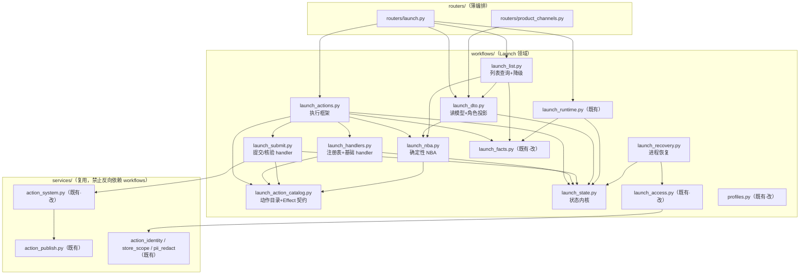
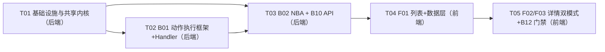

# 增量设计：Launch Center P0 闭环（B01 动作执行 / B02 NBA / B10 Launch API / F01-F03 前端）

> 版本：v1（2026-10-12）。上游：`docs/INCREMENT_PRD_LAUNCH_P0_CLOSURE.md`（v1 冻结范围，101 条 AC）。
> 代码基线：提交 `5a0ae0f`（Launch runtime 已提交）；所有「已存在」判断以当前代码为准。
> 本文件只做设计（签名级），不写实现代码；偏离规范之处按 AGENTS.md §10 记入 `docs/DECISIONS.md`（建议 D62 起）。
> 说明：文中标注 `<!-- docs-ok: 计划文件，本轮实施时创建 -->` 的行为**本轮计划新建**的文件路径（尚未落盘），按仓库既有约定（见 `docs/PLATFORM_COMMERCE_WORKFLOW_GAP_ANALYSIS.md）豁免文档一致性校验；实施完成后这些标记即事实路径。

---

## 1. 总体方案

### 1.1 设计目标与策略

在既有 Launch runtime（Profile 版本化、Run/Step/Event 持久化、店铺派生草稿、确定性就绪度 DAG、revision CAS 原子刷新、素材权利门禁）之上，补齐「动作执行 → 确定性 NBA → Launch API → 上线中心页面」的 P0 最小闭环。策略：

1. **不新建第二套体系**：审批/执行复用 `services/action_system.py` 与 `services/action_publish.py`；就绪度/刷新复用 `launch_rules.evaluate_readiness` + `launch_runtime.refresh_launch`；身份/Scope 复用 `launch_access`/`store_scope`/`action_identity`；分页复用 `pagination`；脱敏复用 `pii_redact`。
2. **零迁移**：全部状态落在既有列（`WorkflowStep.result/evidence_refs/external_*/attempts`、`WorkflowRun.*`、`WorkflowEvent.*`、`AiAction.evidence`、`PlatformPublishAttempt`），见 §5。
3. **未接通即禁用**：B03-B09 领域动作本轮 `executable=false` + `disabled_reason`，直接调用 409 `ACTION_NOT_ALLOWED`。
4. **规模纪律**：所有新模块预估 ≤300 行（警戒线）；唯一超警戒的是 `action_system.py`（已 312 行），本轮限定增幅 ≤15 行并给出拆分预案。

### 1.2 新增 / 修改文件清单

#### 后端新增（11 个）

| 文件 | 职责 | 预估行数 | 超警戒线 |
|---|---|---|---|
| `backend/app/workflows/launch_action_catalog.py` | 动作元数据目录（权限/来源状态/风险/批准/连通性/载荷契约）、`ActionContext`/`StepEffect` 数据类、`validate_payload` | ~150 | 否 | <!-- docs-ok: 计划文件，本轮实施时创建 -->
| `backend/app/workflows/launch_state.py` | 共享状态内核：`state_snapshot`/`plan_changes`/`append_event`/`next_sequence`/`action_step_projection`/`land_completed_waits`/`facts_digest` | ~170 | 否 | <!-- docs-ok: 计划文件，本轮实施时创建 -->
| `backend/app/workflows/launch_handlers.py` | `HANDLERS` 注册表 + `COMPLETE_DATA`/`RETRY`/`CANCEL`/`ABANDON_PRODUCT` handler | ~200 | 否 | <!-- docs-ok: 计划文件，本轮实施时创建 -->
| `backend/app/workflows/launch_submit.py` | `SUBMIT_PLATFORM`/`CONFIRM_ACTIVATION` handler（复用 action_system 审批队列） | ~170 | 否 | <!-- docs-ok: 计划文件，本轮实施时创建 -->
| `backend/app/workflows/launch_actions.py` | 动作执行框架：通用校验链、幂等重放、revision CAS、步骤状态机守卫、事件编排、`execute_launch_action` | ~230 | 否 | <!-- docs-ok: 计划文件，本轮实施时创建 -->
| `backend/app/workflows/launch_nba.py` | 确定性 NBA：`allowed_actions`/`disabled_actions`/`blocked_reason`/`owner`/`next_best_action`/`recommendations(source=rule)` | ~160 | 否 | <!-- docs-ok: 计划文件，本轮实施时创建 -->
| `backend/app/workflows/launch_dto.py` | 读模型 DTO：列表项/详情/步骤/事件/context/渠道聚合 + COMPLIANCE 角色投影 + 事件脱敏 | ~230 | 否（接近 300；>280 行时把 `event_dto`/`context_dto`/`channels_dto` 拆到 `launch_dto_read.py`） | <!-- docs-ok: 计划文件，本轮实施时创建 -->
| `backend/app/workflows/launch_list.py` | 列表查询：先 Scope 后分页、SQL 侧筛选、批预取、逐行就绪度 + 单行降级 | ~150 | 否 | <!-- docs-ok: 计划文件，本轮实施时创建 -->
| `backend/app/workflows/launch_recovery.py` | 进程级恢复：有意图 RUNNING 只读不重发、无意图 RUNNING → READY | ~110 | 否 | <!-- docs-ok: 计划文件，本轮实施时创建 -->
| `backend/app/routers/launch.py` | Launch API 八端点（context/create/list/detail/steps/actions/sync/events），薄编排 + 错误 envelope | ~240 | 否 | <!-- docs-ok: 计划文件，本轮实施时创建 -->
| `backend/app/routers/product_channels.py` | `GET /api/products/{id}/channels`（P1，独立文件避免把 `products.py` 推过警戒线） | ~80 | 否 | <!-- docs-ok: 计划文件，本轮实施时创建 -->

#### 后端修改（6 个）

| 文件 | 改动 | 预估行数 | 说明 |
|---|---|---|---|
| `backend/app/workflows/launch_access.py` | `LaunchError` 增补 `blockers`/`current_revision` 字段；`launch_context` 对 Factory 身份返回 404（AC-3.4） | ~63 → ~75 | 向后兼容（新参数默认 None） |
| `backend/app/workflows/launch_facts.py` | 事实扩展：`assets.reasons`、`platform.submission_receipt`、`verified_artifact.ACTIVATION` 谓词；抽出 `launch_facts_from_rows` 供列表批预取 | ~35 → ~85 | 不改变既有 `(facts, predicates)` 返回结构语义 |
| `backend/app/workflows/launch_runtime.py` | 抽出只读计算段 `launch_plan(db, run)`；`_snapshot`/`_changes`/`_record_event` 委托 `launch_state`；`plan_changes` 增加 `completed_at` 落库与回执投影入口 | ~118 → ~160 | 既有测试语义不变（见 §6 风险 R2） |
| `backend/app/services/action_system.py` | `submit_action` 支持 `commit=False`（PUBLISH_LISTING）与 `extra_evidence` 关键字 | ~312 → ~325 | **已超警戒线**：本轮限定 ≤15 行增幅；后续若继续增长，把 `_existing_intent`/`_scope_action`/`_intent_key`（约 60 行）提取到 `services/action_intents.py` | <!-- docs-ok: 计划文件，本轮实施时创建 -->
| `backend/app/workflows/profiles.py` | 新增 `probe_profile(db, ctx, shop_id, environment)`（忽略类目的 Profile 可用性探测，供 context 端点） | ~172 → ~200 | 否 |
| `backend/app/main.py` | 注册 `launch`/`product_channels` 两个路由；lifespan 增加 `recover_launch_steps()` 调用 | ~153 → ~160 | 否 |

#### 后端新增测试（5 个，B12）

| 文件 | 覆盖 | 预估行数 |
|---|---|---|
| `backend/tests/test_launch_actions.py` | 动作框架：幂等重放/冲突、revision CAS、动作目录、步骤状态守卫、权限/Scope、缺键 400、并发、事件不可变、COMPLETE_DATA/RETRY/CANCEL 语义、CONFIRM_ACTIVATION 双权限+独立核验+更正 | ~260 | <!-- docs-ok: 计划文件，本轮实施时创建 -->
| `backend/tests/test_launch_submit_flow.py` | SUBMIT_PLATFORM：预检失败不建 Action、创建/复用 AiAction、审批执行回执、sync 落地、失败→FAILED→RETRY、uncertain 待核查、绑定店铺 | ~220 | <!-- docs-ok: 计划文件，本轮实施时创建 -->
| `backend/tests/test_launch_nba.py` | NBA 确定性（同输入双算一致）、排序、disabled_actions、owner、并行分支、AI 边界数据结构 | ~140 | <!-- docs-ok: 计划文件，本轮实施时创建 -->
| `backend/tests/test_launch_api.py` | HTTP 契约：分页 422、筛选合法性、先 Scope 后分页、详情 DTO 全字段、只读不落库、步骤角色投影（无价格字段）、事件分页脱敏、sync 模式/载荷、context、创建/relaunch、channels、Factory 404 | ~260 | <!-- docs-ok: 计划文件，本轮实施时创建 -->
| `backend/tests/test_launch_recovery.py` | 进程恢复：无意图 RUNNING→READY、有意图保持 RUNNING 不重发、重复启动幂等 | ~120 | <!-- docs-ok: 计划文件，本轮实施时创建 -->

#### 前端新增（9 个）

| 文件 | 职责 | 预估行数 | 超警戒线 |
|---|---|---|---|
| `frontend/src/composables/launchCenter.js` | 数据层：列表/详情/步骤/事件/context 加载、动作执行（`Idempotency-Key` + `expected_revision`）、sync、409 保留输入、`return_to` 白名单、纯函数（状态文案/空态原因/Guided 摘要） | ~210 | 否 | <!-- docs-ok: 计划文件，本轮实施时创建 -->
| `frontend/src/views/LaunchCenter.vue` | F01 上线中心列表：列齐全、筛选、空态分因、历史展开、行点击带回筛选 | ~260 | 否 | <!-- docs-ok: 计划文件，本轮实施时创建 -->
| `frontend/src/views/LaunchDetail.vue` | F02/F03 详情：三态摘要、时间线、步骤面板、动作对话框编排、双模式切换 | ~240 | 否 | <!-- docs-ok: 计划文件，本轮实施时创建 -->
| `frontend/src/components/LaunchTimeline.vue` | 流程时间线（并行分组 + 依赖标记，非固定线性进度条） | ~140 | 否 | <!-- docs-ok: 计划文件，本轮实施时创建 -->
| `frontend/src/components/LaunchStepPanel.vue` | 步骤详情（说明/要求/缺项/证据/外部反馈/责任人/下一动作/可执行动作） | ~190 | 否 | <!-- docs-ok: 计划文件，本轮实施时创建 -->
| `frontend/src/components/LaunchStatusSummary.vue` | 三类状态摘要 + 本地验证标注 + monitoring UNAVAILABLE | ~90 | 否 | <!-- docs-ok: 计划文件，本轮实施时创建 -->
| `frontend/src/components/LaunchActionDialog.vue` | 动作确认对话框（备注/材料引用/高危二次确认、409 保留输入、结果待核查文案） | ~130 | 否 | <!-- docs-ok: 计划文件，本轮实施时创建 -->
| `frontend/src/components/LaunchExperienceToggle.vue` | GUIDED/PROFESSIONAL 同页切换（不持久化、不带授权含义） | ~60 | 否 | <!-- docs-ok: 计划文件，本轮实施时创建 -->
| `frontend/tests/launch-center.test.js` | 纯函数单测（vitest，延续 permissions.test.js 模式） | ~120 | 否 | <!-- docs-ok: 计划文件，本轮实施时创建 -->

#### 前端修改（4 个）

| 文件 | 改动 |
|---|---|
| `frontend/src/api.js` | 响应拦截器兼容结构化 `detail`（对象时取 `detail.message`，供 Launch 错误 envelope 展示） |
| `frontend/src/router.js` | 新增 `/launch`（列表）与 `/launch/:id`（详情）路由 |
| `frontend/src/views/Layout.vue` | 「商品」菜单组新增「上线中心」；COMPLIANCE 菜单白名单加 `/launch` |
| `frontend/src/permissions.js` | `APPROVER_PATHS` 匹配改为支持 `/launch` 前缀（合规员可进列表与详情） |

#### 文档（1 个）

| 文件 | 改动 |
|---|---|
| `docs/DOCUMENT_MAP.md` | 登记本设计文档（H 项强制同步；文档须 UTF-8 无 BOM、LF、闭合代码栅栏，过 `test_docs_consistency.py`） |

**合计：新增 25 个、修改 11 个，共 36 个文件。**

### 1.3 模块划分与依赖方向



依赖方向遵守 `routers/ -> workflows/ -> services/ -> models.py`：`services/` 不 import `workflows/`（`action_system` 保持对 Launch 无感知，Launch 侧单向复用）；`workflows/` 不 import `routers/`。无循环依赖（`catalog ← handlers/submit ← actions`、`catalog ← nba ← actions`、`state ← runtime/actions/dto`）。

---

## 2. 关键设计决策

### D1 动作执行放 `workflows/launch_actions.py`，不放 `services/` <!-- docs-ok: 计划文件，本轮实施时创建 -->

**决策**：执行框架与 handler 放 `workflows/`，与 `launch_records`/`launch_runtime` 同层；对 `action_system` 的复用是 `workflows/ → services/` 单向调用。

**理由**：① 分层红线允许 `workflows → services`，禁止方向会破坏 `action_system` 的通用性（通用 Action 系统不该知道 Launch 存在）；② Launch 写路径的关键既有模式（`ensure_write_transaction` + `begin_nested` + revision CAS + 同事务事件）都在 `workflows/`，放同层可直接复用 `launch_state` 共享内核，避免把事务语义复制到 `services/`；③ `launch_records`/`launch_runtime` 已在 `workflows/` import `services/`，方向一致性可查。

**≤300 行策略**（四件套拆分，单一职责）：
- `launch_action_catalog.py`：纯数据（动作元数据 + 载荷契约 + `ActionContext`/`StepEffect` 数据类），无逻辑； <!-- docs-ok: 计划文件，本轮实施时创建 -->
- `launch_handlers.py` + `launch_submit.py`：`HANDLERS` 注册表 + 5 个 handler（按「是否触碰 AiAction/Attempt」二分，后者集中在一个文件，便于审批复用逻辑内聚评审）； <!-- docs-ok: 计划文件，本轮实施时创建 -->
- `launch_actions.py`：只做通用校验链 + 幂等 + CAS + 事件编排，不认识任何具体业务动作（新增动作只改 catalog + handlers，框架不动）。 <!-- docs-ok: 计划文件，本轮实施时创建 -->

### D2 幂等键设计：动作幂等与 `run.idempotency_key` 的关系

**决策**：
- **创建幂等**（既有）：`WorkflowRun.idempotency_key = sha256(客户端创建键)`，唯一键 `uq_launch_request_key` 兜住并发创建。
- **动作幂等**（新增）：请求头 `Idempotency-Key`（非空且 ≤128 字符，缺失/非法 400 `IDEMPOTENCY_REQUIRED`）；服务端派生事件幂等键：
  `event.idempotency_key = "launch:action:" + sha256(f"{run_id}:{step_code}:{action}:{raw_key}").hexdigest()`（长度 78 ≤ 128，命中 `uq_workflow_event_key`）。
- **载荷指纹**：`payload_hash = sha256(canonical_json({step_code, action, payload}))`，存入事件 `payload.payload_hash`。
- **重放判定**：按 `(tenant_id, event.idempotency_key)` 查事件：命中且 `payload_hash` 一致 → 返回原回执（含原 `event_id`，不新建事件、不产生外部意图，且**仍先复核当前权限**）；命中但指纹不一致 → 409 `IDEMPOTENCY_CONFLICT`，零状态变更。

**理由**：动作键与创建键命名空间隔离（前缀不同 + 复合哈希含 run_id），同一把客户端钥匙不会在不同流程间误重放；事件表既有唯一键提供数据库级并发兜底（与 `action_system._intent_key` 的「数据库唯一键兜住并发提交」同构）；哈希而非原文入库，避免超长/含 PII 的客户端键落库。

### D3 revision CAS 与步骤状态机守卫（条件 UPDATE rowcount 判定）

**决策**：
- **Run 级 CAS**（沿用 `refresh_launch` 模式）：
  `UPDATE workflow_runs SET revision = :expected+1, <run 变更> WHERE id=:id AND tenant_id=:t AND flow_kind='PLATFORM_LAUNCH' AND revision=:expected`，`rowcount != 1` → 409 `REVISION_CONFLICT`（响应带 `current_revision`，保存点回滚、零状态变更）。
- **步骤状态机守卫**（新增）：目标步骤按动作矩阵的来源状态做条件更新：
  `UPDATE workflow_steps SET step_status=:to, ... WHERE id=:step_id AND step_status=:expected_from`，`rowcount != 1` → 409 `STEP_STATE_CONFLICT`（附 `blocking_reason`）。
- **事务形状**：`ensure_write_transaction(db)`（SQLite `BEGIN IMMEDIATE` 拿写锁，序列化并发动作）→ `db.begin_nested()` 保存点包住「handler 领域工作 + CAS + 步骤写 + 事件」→ 保存点释放 → router 提交；任一校验失败回滚保存点。

**理由**：AC-4.9（两个动作并发同一 `expected_revision` 只有一个成功）由 run 级 CAS 保证；步骤守卫让「READY→COMPLETED」「FAILED→READY」等迁移显式化并可被测试直接断言（不依赖 ORM 脏检查）；保存点保证 handler 中间写库（如 `submit_action` flush 的 AiAction）在 CAS 失败时整体撤销（`launch_records` 已验证该模式）。

### D4 SUBMIT_PLATFORM 复用 PUBLISH_LISTING 审批队列的边界与回写方案

**决策（复用边界）**：

| 环节 | 承担方 | 说明 |
|---|---|---|
| 预检 | Launch 侧调用 `action_publish.publish_facts` | 平台规则/合规闸门/素材权利/上架复核/店铺授权全在 `publish_facts` 内；失败统一转 409 `ACTION_PRECONDITION_FAILED`，不建 AiAction、不产生 Attempt（AC-6.1） |
| 提案创建/复用 | Launch 侧调用 `action_system.submit_action` | `agent_type="listing"`、`target_id=run.listing_id`、`payload={"shop_id": run.shop_id}`（店铺派生草稿绑定校验由 `publish_targets` 兜底，AC-6.6）；`extra_evidence={"launch_id", "step_code"}`（PRD 待确认问题 2 的默认假设，零行为变更） |
| 审批/执行 | **完全复用既有** `/api/actions/{id}/approve|execute` | Launch 不建第二套审批（PRD §9）；前端审批队列沿用 `publishActionQueue.js` |
| 步骤状态 | Launch 侧 | 提交后 `WAITING_APPROVAL`；事件含 `action_id` 与指纹（AC-6.2） |

**回写方案（确定：无 webhook，惰性 read-back）**：
1. `launch_facts` 暴露 `platform.submission_receipt = {attempt_id, external_id, platform_status, verification_status, external_object_type, mapping_version, received_at}`（仅匹配 listing+shop 且 `status="succeeded"` 且 `external_id` 非空的 Attempt；CONTRACT_TEST 或非 demo 店，既有语义不变）。
2. **审批通过并执行成功后**（Attempt succeeded），下一次 `refresh_launch`（sync、manage 方详情读、动作后重算）中 `launch_state.land_completed_waits` 把满足 `completion_satisfied=True` 的 `WAITING_APPROVAL` 步骤落地为 `COMPLETED`，并把回执固定进 `step.result.receipt` + `evidence_refs=["attempt:{id}"]`（AC-6.3）。
3. `run.platform_status` 由回执投影为 `SUBMITTED`（仅当处于 `NOT_SUBMITTED/UNKNOWN`）；**绝不**自动置 `ACTIVE`/`VERIFIED`（AC-6.4）；`verification_status` 只由 `CONFIRM_ACTIVATION` 置 `VERIFIED(source=MANUAL)`。
4. AiAction 状态→步骤状态投影（`action_step_projection`，每次刷新前执行）：`PENDING_APPROVAL→WAITING_APPROVAL`、`APPROVED→WAITING_APPROVAL`、`EXECUTING→RUNNING`、`FAILED→FAILED`（错误脱敏入 `step.result.error`，`attempts+1`，仅迁移时一次）、`REJECTED→READY`（记录 `result.rejection_note`，允许改后重提）、`SUCCESS` 不投影（交给回执落地）。

**理由**：webhook（B11）本轮明确不做；read-back 是确定性的（输入只有服务端事实），且与「详情/sync 刷新」的既有机制同构；审批队列零改动。**重提不死锁**：`_scope_action` 会按 `scope_key` 复用任意终态 Action，因此 Launch 侧提交序号后缀：首次 `scope_key=f"launch:{run_id}:{step_code}:1"`，第 n 次新提案 `:n`（n=该步骤已有 Launch 关联 Action 数+1）；非终态 Action（PENDING_APPROVAL/APPROVED/EXECUTING/SUCCESS）复用同一 Action（AC-6.2），终态（REJECTED/FAILED）不复用、强制新建意图（AC-8.1）。此格式在 PRD 假设 2 基础上增加序号后缀，理由见 §6-R4。

### D5 CONFIRM_ACTIVATION 核验记录存储（采纳 PRD 默认假设 1，零迁移）

**决策**：核验事实落盘到 `WorkflowStep.result`（JSON）+ 不可变事件，不建独立表。
```json
// step.result
{"activation_verification": {"current": {"reviewer_id": 7, "material_ref": "...", "note": "...",
 "reviewed_at": "...", "source": "MANUAL", "correction_of": null},
 "history": [{"...上一版核验..."}]}}
```
- `launch_facts` 据 `result.activation_verification.current` 派生谓词 `verified_artifact: {"ACTIVATION": True}`，使 PLATFORM_ACTIVATION 的 `completion_condition` 可被服务端事实满足（否则该步骤永远无法完成）。
- handler 同事务写 `run.platform_status=ACTIVE`、`run.verification_status=VERIFIED`、步骤 `COMPLETED`、事件 `LaunchActivationVerified`（payload 含 reviewer/material_ref/note/reviewed_at）。
- 误判更正：新事件 + `history` 追加、`current` 替换并带 `correction_of`，不擦除历史（AC-7.5）。

**理由**：`WorkflowStep.result` 正是指定证据列；独立表需迁移 + 合成历史库 roundtrip（AC-18.5 明确倾向零迁移），本轮无功能收益；冻结状态模型 §5 已支持人工核验作为首期在售路径，强制独立核验人与可追溯材料由权限与证据结构保证。生产独立表方案见 §5 预案。

### D6 NBA 放新模块 `workflows/launch_nba.py`，保证确定性 <!-- docs-ok: 计划文件，本轮实施时创建 -->

**决策**：不扩展 `launch_rules.py`（保持其为「事实→就绪度」纯函数），NBA 独立成模块。

**理由**：① NBA 的输入包含「当前身份权限」与「handler 连通性目录」，混入 `launch_rules` 会破坏其纯事实语义并迫使规则层依赖动作目录；② 独立模块可单测确定性（AC-9.2）；③ 规模纪律（`launch_rules` 118 行 + NBA ~160 行会贴近警戒）。

**确定性保证**：`compute_nba` 是纯函数——输入仅 `(plan, steps, definitions, permissions, role, revision, facts_digest, run)`，不读时钟、不随机、不访问 DB；排序键完全确定：
`(external_confirm, not_unblocks, deadline, sequence, step_code)`，其中：
- `external_confirm = 1` 当 `approval_required` 或步骤 `actor ∈ {PLATFORM, REVIEWER, FACTORY}`（安全依赖：不依赖外部确认者优先）；
- `not_unblocks = 0` 当该步骤当前有 `blocking_reason`（阻断解除优先）；
- `deadline` 取 `step.deadline_at`（无则 `datetime.max`）；`sequence`/`step_code` 兜底保证全序。
`next_best_action` 取 `allowed_actions` 首项；无 executable 动作时取 `disabled_actions` 首项并带 `disabled_reason`（AC-9.5）。`allowed_actions` 遍历**所有** READY 步骤而非仅焦点步骤（AC-9.8 并行分支）。

### D7 列表页逐行就绪度的性能策略（N+1 控制 + 单行降级）

**决策**：列表行**重算就绪度**（保证下一动作/阻断摘要权威，AC-1.2、AC-10.6 的前提），但用四层控制查询量：
1. **先 Scope 后分页**：`StoreScope.filter(query, WorkflowRun.shop_id)` → 筛选（SQL 侧，见 §3.2）→ `count` → `order_by(created_at desc)` → offset/limit；`total` 不含不可见记录（AC-1.1/14.4）。
2. **批预取**（每页 5 条查询）：`Product.id IN (...)`、`Shop.id IN (...)`、`Listing.id IN (...)`、`WorkflowStep.run_id IN (...)`、`PlatformPublishAttempt.listing_id IN (...)`，按页聚合，杜绝逐行主表 N+1。
3. **逐行仅剩 1 次查询**：`evaluate_asset_rights`（按 tenant+product 索引）+ 纯 CPU 的 `evaluate_readiness`/`compute_nba`；`launch_facts_from_rows` 直接消费批预取行。
4. **单行降级**（AC-10.6）：每行包 `try/except LaunchError`：`LAUNCH_CONTEXT_CHANGED`/`LAUNCH_DEFINITION_CORRUPT`/`LAUNCH_TARGET_INVALID` → 该行 `blocked_summary=[{code: <错误码>, message, step_code: null, owner_actor: null}]`、`next_action={action: null, step_code: null, executable: false, reason: "请进入详情刷新状态"}`，整页不失败。

**上限声明**：`page_size` 默认 20、上限 200（超限 422）。200 行/页时约 205 次查询，SQLite 本地可接受；若成为热点，后续增量为 `ProductAsset` 增加批预取（把 `evaluate_asset_rights` 拆出「行预加载」变体），本轮不做（YAGNI，且不影响正确性）。

### D8 COMPLIANCE 角色投影在 DTO 序列化层实现

**决策**：投影放在 `launch_dto.step_dto/launch_detail/launch_list_item`（序列化层），不做第二套查询：
- **结构性保证**：Launch 全部 DTO 不定义价格/成本/利润率/备货数字段（契约测试对响应 JSON 递归断言这些 key 不存在，AC-3.2 自本轮起成为契约）；
- **动作过滤**：`role == "COMPLIANCE"` 时，`PRICE_STOCK_ACTIONS = {REPORT_PRICE, ACCEPT_PRICE, COUNTER_PRICE, REQUEST_STOCK, CONFIRM_STOCK, ABANDON_PRODUCT}` 从 `available_actions`/`disabled_actions` **完全移除**（不是置灰）；
- 其他角色：权限不足的动作进 `disabled_actions` 且 `disabled_reason="缺少权限：<key>"`；未接通动作 `disabled_reason` 指向责任领域与后续批次。

**理由**：投影是「同一事实的不同视图」，属序列化职责；放查询层会导致两套查询漂移；`WorkspaceContext.role` 是唯一角色源（与 `workspace_context.ROLE_PERMISSIONS` 一致，不引入第二事实源）。

### D9 前端目录结构（LaunchCenter 拆分）

**决策**：
- 路由两条：`/launch`（列表 `LaunchCenter.vue`）、`/launch/:id`（详情 `LaunchDetail.vue`）；行点击进详情并携带 `return_to`（站内白名单路径，AC-14.7）。 <!-- docs-ok: 计划文件，本轮实施时创建 -->
- `LaunchDetail.vue` 只做编排（数据加载、模式切换、动作流），重 UI 拆到 `components/Launch*.vue`（Timeline/StepPanel/StatusSummary/ActionDialog/ExperienceToggle），单组件全部 ≤300 行。 <!-- docs-ok: 计划文件，本轮实施时创建 -->
- 数据层集中 `composables/launchCenter.js`：纯函数（状态文案、空态原因、Guided 摘要、`return_to` 校验、幂等键生成）可被 vitest 直接测；组件只消费。 <!-- docs-ok: 计划文件，本轮实施时创建 -->
- F03 双模式 = 同组件内 `experienceMode` ref（初值来自 `context.effective_experience_mode`，切换不写 URL/不持久化/不重新鉴权；刷新回默认并明示，AC-16.4）；两种模式读同一 DTO（AC-16.5）。

### D10 动作执行后状态收敛：handler 断言 + 回执落地 + 一次事务一次事件

**决策**：动作事务内三步收敛，避免调用 `refresh_launch` 造成双 CAS/双事件/权限再复核：
1. handler 返回 `StepEffect`（可断言目标步骤终态、`result` 合并、`evidence_refs` 追加、`run_fields`、`cancelled`、`receipt`）；
2. 框架以「持久状态 + AiAction 投影 + handler 断言」为输入重算 `launch_plan`，`land_completed_waits` 迭代落地（≤步骤数次，DAG 无环必收敛）；
3. `plan_changes` 一次性计算 run/步骤 diff，**一次**条件 UPDATE + **一条**动作事件（`LaunchActionExecuted`/`LaunchActivationVerified`/`LaunchActionRetried`/`LaunchCancelled`）。

**后置不变量**：handler 断言了终态时，重算计划必须给出同一状态，否则 409 `ACTION_PRECONDITION_FAILED`（防「假成功」；同事务内事实刚读取，正常不会触发）。

### D11 handler 失败分类与回执语义

**决策**：
- **前置失败**（校验链/预检/权限/幂等冲突）：4xx，零状态变更，**不写事件**（AC-4.6/5.2/6.1）。
- **领域失败**（`publish_facts`/`submit_action` 抛 `ActionError`，如内容变化、已有不同提案）：转 `LaunchError("ACTION_PRECONDITION_FAILED", msg, 409)`，零状态变更。
- **意外异常**（非 `LaunchError`/`ActionError`）：落 `step_status=FAILED`、`attempts+1`、错误 `redact` 入 `step.result.error`，写 `LaunchActionFailed` 事件，revision+1，HTTP **200** + `{status: "FAILED", receipt: {error}}`（与既有 `execute_action` 对 FAILED 的 200 语义一致，`ActionExecuteResponse.status` 枚举含 FAILED）。

### D12 进程级恢复（AC-8.5）

**决策**：`launch_recovery.recover_launch_steps(db)` 在 `main.py` lifespan（`recover_incomplete_runs()` 之后）以系统身份扫描全部未结束 `PLATFORM_LAUNCH`：
- 步骤 `RUNNING` 且**有持久外部意图**（`step.result.action_id` 指向的 AiAction 存在，或存在 `evidence.launch_id/step_code` 匹配的 AiAction）：保持 `RUNNING`，首次标注 `result.pending_verification=true` + `LaunchRecovered` 事件（「结果待核查」），**不重发**；
- 步骤 `RUNNING` 且**无意图**：条件更新 `RUNNING → READY` + `LaunchRecovered` 事件；
- 已成功外部调用不重复（`PlatformPublishAttempt` 唯一键 + `execute_action` 的 SUCCESS 重放返回原 outcome，既有机制）。
sync 端点对单 run 复用 `recover_run_steps`（满足矩阵「经 sync」的 launch:manage 约束）；启动扫描是确定性冻结规则的状态回收，不代替用户 sync 的 read-back。

---

## 3. 接口契约

### 3.1 后端函数签名（模块.函数名 + 参数 + 返回 + 抛错）

#### `workflows/launch_access.py`（改）
```python
class LaunchError(ValueError):
    def __init__(self, code: str, message: str, status_code: int = 400,
                 existing_launch_id: int | None = None,
                 blockers: list | None = None, current_revision: int | None = None): ...
    # 属性: code / status_code / existing_launch_id / blockers / current_revision

def launch_context(db, ctx, permission: str = "launch:read") -> tuple[WorkspaceContext, StoreScope]:
    """fresh_context + Store Scope + 权限；Factory 身份一律 404 LAUNCH_NOT_FOUND（AC-3.4，不泄露存在性）。"""
    # 抛 LaunchError: SCOPE_DENIED(403) / PERMISSION_DENIED(403) / LAUNCH_NOT_FOUND(404, Factory)

def owned_launch(db, current, scope, run_id: int) -> WorkflowRun: ...      # 既有不变；404 LAUNCH_NOT_FOUND
def require_shop_scope(scope, shop_id: int) -> None: ...                   # 既有不变
```

#### `workflows/launch_action_catalog.py`（新） <!-- docs-ok: 计划文件，本轮实施时创建 -->
```python
@dataclass(frozen=True)
class ActionMeta:
    business_types: frozenset[str]   # 适用步骤 business_type
    permissions: tuple[str, ...]     # 所需权限（全部满足）
    source_states: frozenset[str]    # 步骤来源状态
    target: str                      # "step" | "run"
    risk: str                        # LOW/MEDIUM/HIGH
    approval_required: bool
    connected: bool                  # 本轮是否有 handler
    disabled_reason: str             # 未接通/后续批次说明
    required_payload: frozenset[str]
    optional_payload: frozenset[str]
    external_confirmer: bool         # NBA 安全依赖排序用

@dataclass
class ActionContext:
    db: Session; run: WorkflowRun; step: WorkflowStep | None
    current: WorkspaceContext; payload: dict; facts: dict
    plan: dict; definition: StepDefinition | None

@dataclass
class StepEffect:
    status: str | None = None          # 断言的目标步骤终态
    result: dict | None = None         # 合并进 step.result
    evidence_refs: list | None = None  # 追加
    attempts_delta: int = 0
    run_fields: dict | None = None     # run 级字段（platform_status 等）
    cancelled: bool = False
    receipt: dict | None = None
    external: dict | None = None       # {status, reference, type}

BUSINESS_ACTION_META: dict[str, ActionMeta]   # 全部已注册业务动作（含未接通）
PRICE_STOCK_ACTIONS: frozenset[str]           # COMPLIANCE 投影剔除集

def action_meta(action: str) -> ActionMeta:
    """抛 LaunchError("ACTION_NOT_ALLOWED", "动作不在执行目录："+action, 409)"""

def validate_payload(action: str, payload: dict) -> dict:
    """严格校验 per-action 键（拒绝 completed/status/platform_status 等完成标记），note 截断；
    抛 LaunchError("ACTION_PAYLOAD_INVALID", msg, 422)；返回规范化 payload。"""
```

#### `workflows/launch_state.py`（新） <!-- docs-ok: 计划文件，本轮实施时创建 -->
```python
def state_snapshot(run, steps) -> dict:
    """{revision, execution_status, platform_status, verification_status, current_step,
       blocked_reason, steps:{code:{status, blocking_reason, input_revision}}}（自 launch_runtime._snapshot 迁出）"""

def plan_changes(run, steps, plan, *, overrides: dict | None = None,
                 run_overrides: dict | None = None, receipt: dict | None = None,
                 now=None) -> dict:
    """纯计算 run/步骤 diff：{"run": {...}, "steps": {code: {...}}}。
    - run：execution_status/current_step/blocked_reason 取自 plan；platform_status 按 receipt 投影
      （仅 NOT_SUBMITTED/UNKNOWN → receipt.platform_status）；execution_status 转 COMPLETED 且
      completed_at 为空时补 completed_at；started_at 既有逻辑。
    - steps：plan 驱动 status/blocking_reason/input_revision + overrides 合并（result/evidence_refs/
      attempts/external_*/status 断言）。
    抛 ValueError（计划与实例不一致时由调用方转换）。"""

def next_sequence(db, run_id: int) -> int:
    """COALESCE(MAX(sequence),0)+1（uq_workflow_event_sequence 兜底）"""

def append_event(db, run, *, event_type: str, idempotency_key: str, source: str,
                 actor_id: int | None, before: dict, after: dict, payload: dict,
                 sequence: int | None = None) -> WorkflowEvent: ...

def action_step_projection(db, run, steps) -> dict[str, dict]:
    """AiAction 状态 → 步骤状态投影（只读）。返回 {step_code: {"step_status", "result", "attempts_delta"}}，
    仅包含与持久状态不同的迁移（保证 attempts+1 只发生一次）。"""

def land_completed_waits(db, run, steps, plan, facts) -> dict[str, dict]:
    """completion_satisfied=True 的等待态步骤按完成条件落地 COMPLETED：
    - PLATFORM_SUBMISSION：需 result.action_id 对应 AiAction.status==SUCCESS 且 facts 有 submission_receipt；
      固定 receipt 进 result + evidence_refs。
    - PLATFORM_ACTIVATION：需 result.activation_verification.current 存在。
    其他业务类型不落地（未接通无意图解析）。返回 {step_code: {"step_status": "COMPLETED", "result", "evidence_refs"}}"""

def facts_digest(facts: dict, predicates: dict) -> str:
    """sha256(canonical_json([facts, predicates]))，作为 NBA evidence_fingerprint 基底"""

def platform_receipt(facts: dict) -> dict | None:
    """取 facts["platform"]["submission_receipt"]，无则 None"""
```

#### `workflows/launch_facts.py`（改）
```python
def load_launch_facts(db, run) -> tuple[dict, dict]:
    """既有签名不变；扩展：facts["assets"]["reasons"]、facts["platform"]["submission_receipt"]、
       predicates["verified_artifact"]={"ACTIVATION": bool}（据 ACTIVATION 步骤 result 派生）。
       抛 LaunchError: LAUNCH_TARGET_INVALID(409) / LAUNCH_CONTEXT_CHANGED(409)"""

def launch_facts_from_rows(db, run, product, listing, shop, attempt) -> tuple[dict, dict]:
    """列表批预取复用：主行由调用方提供，仅保留 asset_rights 查询；抛错同上"""
```

#### `workflows/launch_runtime.py`（改）
```python
def launch_plan(db, run) -> tuple[ProfileDefinition, list[WorkflowStep], dict, dict, dict]:
    """只读计算段：定义/步骤完整性校验 + load_launch_facts + evaluate_readiness（不写库）。
    抛 LaunchError: LAUNCH_DEFINITION_CORRUPT(409) / LAUNCH_TARGET_INVALID(409) / LAUNCH_CONTEXT_CHANGED(409)"""

def refresh_launch(db, ctx, run_id: int, expected_revision: int) -> tuple[WorkflowRun, dict]:
    """既有签名/语义不变；内部改用 launch_plan + launch_state.plan_changes/append_event；
    刷新前执行 action_step_projection + land_completed_waits 收敛。"""
```

#### `workflows/launch_handlers.py`（新） <!-- docs-ok: 计划文件，本轮实施时创建 -->
```python
HANDLERS: dict[str, Callable[[ActionContext], StepEffect]]   # 注册表（含 launch_submit 的两个）

def complete_data(ctx: ActionContext) -> StepEffect:
    """条件已由 NBA 门禁确定满足；固定证据 {input_revision, facts_digest, completed_by, completed_at}；
    断言 status="COMPLETED"。抛 LaunchError("ACTION_PRECONDITION_FAILED", msg, 409, blockers=asset_rights.reasons)"""

def retry_step(ctx: ActionContext) -> StepEffect:
    """FAILED → READY（经规则重算），attempts+1，事件记 predecessor；
    PLATFORM_SUBMISSION 且 Attempt.status=="uncertain" 或 AiAction=="EXECUTING" 时
    抛 LaunchError("ACTION_PRECONDITION_FAILED", "外部结果待核查，请先同步核对", 409)"""

def cancel_run(ctx: ActionContext) -> StepEffect:
    """CANCEL 与 ABANDON_PRODUCT 同语义：ended_at=now、active_slot=None、cancelled=True；
    已核验在售（platform_status==ACTIVE 且 verification_status==VERIFIED）抛
    LaunchError("ACTION_PRECONDITION_FAILED", "已核验在售的流程不能取消", 409)。不调用任何外部下架/退款"""
```

#### `workflows/launch_submit.py`（新） <!-- docs-ok: 计划文件，本轮实施时创建 -->
```python
def submit_platform(ctx: ActionContext) -> StepEffect:
    """预检 publish_facts → submit_action(commit=False, scope_key=f"launch:{run_id}:{step_code}:{n}",
    extra_evidence={"launch_id","step_code"})；复用非终态 Action；断言 status="WAITING_APPROVAL"、
    result={"action_id","submission_seq","facts":{fingerprint, rule_version}}。
    抛 LaunchError: ACTION_PRECONDITION_FAILED(409, ActionError 转换，blockers 含具体缺项)"""

def confirm_activation(ctx: ActionContext) -> StepEffect:
    """校验执行者同时持 launch:submit + compliance:approve 且与提交人/报告人不同（否则 403/409）；
    写核验记录（reviewer_id/material_ref/note/reviewed_at/source=MANUAL，history 追加）；
    run_fields={"platform_status":"ACTIVE","verification_status":"VERIFIED"}；断言 status="COMPLETED"。
    抛 LaunchError("ACTION_PRECONDITION_FAILED", msg, 409)"""
```

#### `workflows/launch_actions.py`（新） <!-- docs-ok: 计划文件，本轮实施时创建 -->
```python
def execute_launch_action(db, ctx, run_id: int, action: str, body: dict,
                          idempotency_key: str) -> dict:
    """返回 {"revision","action","status","step","receipt","event_id","run","plan"}；
    status ∈ EXECUTED|PENDING_APPROVAL|FAILED。
    校验链（按序，全部零状态变更）：
      1. 幂等键格式（400 IDEMPOTENCY_REQUIRED）
      2. launch_context(launch:read) + owned_launch（404）
      3. 幂等重放查询（同键同载荷返回原回执；异载荷 409 IDEMPOTENCY_CONFLICT）
      4. expected_revision 类型（400 REVISION_REQUIRED）/ 一致（409 REVISION_CONFLICT+current_revision）
      5. 生命周期 ended_at/CANCELLED（409 LAUNCH_ENDED；CANCEL 自身豁免）
      6. 步骤定位与动作目录（动作∈冻结快照 available_actions，run 级动作豁免；409 ACTION_NOT_ALLOWED+disabled_reason）
      7. 载荷契约（422 ACTION_PAYLOAD_INVALID）
      8. 权限目录（403 PERMISSION_DENIED）
      9. NBA 门禁：动作∈当前身份 allowed_actions（409 ACTION_PRECONDITION_FAILED+blockers）
      10. 步骤状态守卫来源状态（409 STEP_STATE_CONFLICT+blocking_reason）
    事务：ensure_write_transaction → begin_nested → handler → 重算收敛 → run CAS → 步骤条件更新 → 事件 → 释放。
    意外异常：落 FAILED+LaunchActionFailed 事件，返回 status=FAILED。"""

def replay_receipt(event: WorkflowEvent) -> dict:
    """从事件重建 {revision, action, status, step, receipt, event_id}"""
```

#### `workflows/launch_nba.py`（新） <!-- docs-ok: 计划文件，本轮实施时创建 -->
```python
def compute_nba(plan: dict, steps: list, definitions: dict, permissions: frozenset[str],
                *, role: str, revision: int, facts_digest: str, run) -> dict:
    """纯函数。返回：
    {"allowed_actions":[{"action","step_code","permission","approval_required","risk",
      "expected_revision","evidence_fingerprint"}],
     "disabled_actions":[{"action","step_code","disabled_reason"}],
     "blocked_reason":[{code,message,step_code,owner_actor}],
     "owner":{"actor","user_id","role_hint"},
     "next_best_action":{"action","step_code","executable","disabled_reason"?},
     "ordering":"rule"}
    executable 条件：connected ∧ 权限齐 ∧ 步骤状态∈source_states ∧ 动作特判前置
    （COMPLETE_DATA 需 plan completion_satisfied is True；CANCEL 需 run 可取消）。"""

def recommendations(nba: dict, plan: dict) -> list[dict]:
    """确定性解释条目 [{target,reason,source:"rule"}]（每个 allowed_action 与 blocker 各一条，模板固定）"""

def next_action_summary(nba: dict) -> dict:
    """列表用精简 {action, step_code, executable, reason?, owner}"""
```

#### `workflows/launch_list.py`（新） <!-- docs-ok: 计划文件，本轮实施时创建 -->
```python
def list_launches(db, ctx, scope, *, page_num: int, page_size: int,
                  product_id: int | None = None, shop_id: int | None = None,
                  platform: str | None = None, market: str | None = None,
                  execution_status: str | None = None, owner_user_id: int | None = None,
                  mine: bool = False, waiting_platform: bool = False,
                  blocked_only: bool = False, include_history: bool = False,
                  extra_params: set[str] = frozenset()) -> dict:
    """先 Store Scope → SQL 筛选（mine/waiting_platform/blocked_only 均翻译为 SQL EXISTS/IN）→
    created_at 倒序 → 分页；批预取后逐行 facts+readiness+NBA；单行 LaunchError 降级。
    返回 {"items":[...], "total": int, "page_num": int, "page_size": int}。
    抛 LaunchError("FILTER_INVALID", msg+"合法值：...", 422)（未知筛选值/未知查询参数/超限 page_size 由 router 前置）"""
```

#### `workflows/launch_dto.py`（新） <!-- docs-ok: 计划文件，本轮实施时创建 -->
```python
def load_detail(db, ctx, run_id: int) -> dict:
    """launch:read 读详情；持 launch:manage 先 refresh_launch（REVISION_CONFLICT 重读重试一次），
    只读方仅 launch_plan 计算不落库、不改 revision（AC-2.2）。返回 LaunchDetail dict。"""

def launch_list_item(db, run, current, *, product, shop, attempt) -> dict:
    """单行读模型（facts+evaluate_readiness+compute_nba）；LaunchError 向上交由 launch_list 降级"""

def launch_detail(db, run, current, plan, nba) -> dict: ...      # 组装 LaunchDetail（含 recommendations/monitoring/professional_links）
def step_dto(step, definition, *, role: str, revision: int) -> dict: ...   # 含 COMPLIANCE 动作过滤
def event_dto(event) -> dict: ...                                # payload/before/after 深度 redact
def context_dto(db, ctx, scope) -> dict: ...                     # shops/effective_experience_mode/permissions/can_create
def channels_dto(db, ctx, product_id: int) -> dict: ...          # 商品渠道聚合（Scope 外店铺不出现）
def verification_notice(run, definition) -> str | None: ...      # CONTRACT_TEST 或 UNVERIFIED → 固定文案
```

#### `workflows/launch_recovery.py`（新） <!-- docs-ok: 计划文件，本轮实施时创建 -->
```python
def recover_launch_steps(db) -> int:
    """启动扫描（系统身份，无用户 ctx）：全部未结束 PLATFORM_LAUNCH 的 RUNNING 步骤回收；
    返回处理步骤数。不调用任何外部适配器。"""

def recover_run_steps(db, run) -> dict:
    """单 run 回收（sync 路径复用，调用方已校验 launch:manage）。返回 {"steps": {code: {...}}}"""
```

#### `workflows/profiles.py`（改）
```python
def probe_profile(db, ctx, shop_id: int, environment: str) -> tuple[WorkflowTemplate | None, str]:
    """忽略类目匹配的 Profile 可用性探测（context 端点用）。
    返回 (row|None, reason)；reason ∈ "" | "STORE_CONTEXT_MISSING" | "PROFILE_NOT_FOUND" | "PROFILE_AMBIGUOUS"。
    抛 ProfileError（SCOPE_DENIED/TARGET_NOT_FOUND/SOURCE_STORE 等）"""
```

#### `services/action_system.py`（改）
```python
def submit_action(db, ctx, agent_type, proposal, scope_key, *, scope_manifest=None,
                  commit: bool = True, extra_evidence: dict | None = None) -> AiAction:
    """扩展：① commit=False 对 PUBLISH_LISTING 开放（既有仅 UPDATE_LISTING_COMPLIANCE_RISK）；
    ② extra_evidence 合并进 AiAction.evidence（Launch 关联引用，零行为变更）。
    其余语义不变；commit=False 时只 flush 不 commit，由调用方保存点控制。"""
```

#### `routers/launch.py`（新，8 端点） <!-- docs-ok: 计划文件，本轮实施时创建 -->
```python
router = APIRouter(prefix="/launch", tags=["launch"])

@router.get("/context")      def get_context(user=Depends(get_current_user), db=Depends(get_db)) -> dict
@router.post("")             def create_launch(body: LaunchCreateIn,
                                    idempotency_key: str | None = Header(None, alias="Idempotency-Key"),
                                    user=..., db=...) -> dict            # LaunchDetail
@router.get("")              def list_launches(request: Request, page_num: int = PageNum,
                                    page_size: int = PageSize, product_id: int | None = None, ...,
                                    user=..., db=...) -> dict            # {items,total,page_num,page_size}
@router.get("/{run_id}")     def launch_detail(run_id: int, user=..., db=...) -> dict
@router.get("/{run_id}/steps")   def launch_steps(run_id: int, user=..., db=...) -> dict
@router.post("/{run_id}/actions/{action}")
                             def execute_action(run_id: int, action: str, body: ActionIn,
                                    idempotency_key: str | None = Header(None, alias="Idempotency-Key"),
                                    user=..., db=...) -> dict            # ActionExecuteResponse
@router.post("/{run_id}/sync")    def sync_launch(run_id: int, body: SyncIn, user=..., db=...) -> dict
@router.get("/{run_id}/events")   def launch_events(run_id: int, page_num: int = PageNum,
                                    page_size: int = PageSize, user=..., db=...) -> dict
# 路由声明顺序：/context 必须早于 /{run_id}
# 错误 envelope：LaunchError → HTTPException(status_code=exc.status_code,
#   detail={"code","message","blockers","current_revision","existing_launch_id"})
```

#### `routers/product_channels.py`（新） <!-- docs-ok: 计划文件，本轮实施时创建 -->
```python
router = APIRouter(prefix="/products", tags=["products"])
@router.get("/{product_id}/channels")
def product_channels(product_id: int, user=Depends(get_current_user), db=Depends(get_db)) -> dict
```

### 3.2 Launch API 端点契约（对齐 PRD §6，补充确定细节）

#### 通用
- 统一错误体（`HTTPException.detail` 为对象）：
  `{"code": str, "message": str, "blockers": [{code,message,step_code,owner_actor}], "current_revision"?: int, "existing_launch_id"?: int}`
- 列表响应分页字段为 `page_num`（**不**用 `serialize.page` 的 `page`，遵循 PRD §6.3）。
- 时间字段 naive UTC，序列化 `"YYYY-MM-DD HH:MM:SS"`（与 `serialize.to_dict` 一致）。

#### ① GET /api/launch/context（launch:read）
```json
200 {
  "shops": [{"id":1,"name":"Launch A","platform":"shopee","market":"SG","store_type":"",
             "account_type":"","business_mode":"","fulfillment_mode":"DROPSHIP","is_demo":true,
             "status":"authorized","usable":true,"blocked_reason":null,
             "profile_available":true,"profile_key":"SIMPLE_CONTRACT"}],
  "effective_experience_mode":"GUIDED",
  "permissions":["launch:read","launch:create","launch:manage","launch:submit"],
  "can_create":true,
  "blocked_reason":null
}
```
- `shops`：Scope 内 `role="sales"` 且 `platform!="1688"` 且未归档店铺；`blocked_reason.code ∈ STORE_CONTEXT_MISSING/PROFILE_NOT_FOUND/PROFILE_AMBIGUOUS/SOURCE_STORE`。
- 全局 `can_create=false` 时 `blocked_reason.code ∈ PERMISSION_DENIED/NO_USABLE_SHOP/NO_PROFILE`。
- `effective_experience_mode` 取 Workspace 默认常量 `GUIDED`（采纳 PRD 假设 3；Membership 偏好列后续增量）。
- 错误：403 PERMISSION_DENIED / SCOPE_DENIED；Factory 404。

#### ② POST /api/launch（launch:create；头 `Idempotency-Key` 必填 ≤128）
```json
请求 {"product_id":1,"shop_id":2,"parent_listing_id":null,"previous_run_id":null,"environment":"CONTRACT_TEST"}
（extra=forbid；缺键/空/超长 400 IDEMPOTENCY_REQUIRED）
200 LaunchDetail（创建成功返回首屏就绪度与 NBA，AC-13.4）
```
错误：400 IDEMPOTENCY_REQUIRED/TARGET_INVALID/ENVIRONMENT_INVALID；403 PERMISSION_DENIED/SCOPE_DENIED；
404 TARGET_NOT_FOUND/PROFILE_NOT_FOUND（PRODUCTION 无已发布 Profile，AC-13.5）/LISTING_NOT_FOUND；
409 IDEMPOTENCY_CONFLICT/ACTIVE_LAUNCH_EXISTS（+existing_launch_id，前端打开已有流程，AC-13.2）/RELAUNCH_NOT_READY/LAUNCH_CONFLICT。

#### ③ GET /api/launch（launch:read）
- Query：`page_num`(≥1)、`page_size`(1~200，超限 422)、`product_id?`、`shop_id?`、`platform?`、`market?`、`execution_status?`（合法值：NOT_STARTED/READY/RUNNING/WAITING_USER/WAITING_EXTERNAL/WAITING_APPROVAL/BLOCKED/FAILED/COMPLETED/CANCELLED）、`owner_user_id?`、`mine?`、`waiting_platform?`、`blocked_only?`、`include_history?`。**未知查询参数或未知筛选值 → 422 FILTER_INVALID（附合法值/合法键列表，不静默忽略，AC-1.6）**。
- 筛选语义：`mine=true` → EXISTS 分配给当前用户的非终态步骤（READY/WAITING_USER/WAITING_APPROVAL/FAILED，AC-1.4）；`waiting_platform=true` → `platform_status ∈ {SUBMITTED, UNDER_REVIEW}` OR EXISTS `WAITING_EXTERNAL` 步骤（AC-1.5）；`blocked_only=true` → `execution_status ∈ {BLOCKED, FAILED}`；默认 `active_slot=1`，`include_history=true` 含已结束轮次且项带 `is_history=true`（AC-1.3）；排序固定 `created_at` 倒序。
```json
200 {"items":[LaunchListItem],"total":37,"page_num":1,"page_size":20}
```

#### ④ GET /api/launch/{id}（launch:read；manage 触发刷新）
`200 LaunchDetail`。错误：404 LAUNCH_NOT_FOUND；409 LAUNCH_CONTEXT_CHANGED/LAUNCH_DEFINITION_CORRUPT；403。

#### ⑤ GET /api/launch/{id}/steps（launch:read）
```json
200 {"items":[StepDTO],"revision":3,"profile":{"key":"SIMPLE_CONTRACT","version":1,"hash":"..."}}
```

#### ⑥ POST /api/launch/{id}/actions/{action}（权限见动作目录；头 `Idempotency-Key` 必填）
```json
请求 {"step_code":"INFORMATION","expected_revision":3,"payload":{"note":"资料已核对"}}
（run 级动作 step_code=""；extra=forbid；payload 键按动作白名单，见 D2/validate_payload）
200 {"revision":4,"action":"COMPLETE_DATA","status":"EXECUTED",
     "step":{"step_code":"INFORMATION","step_status":"COMPLETED"},
     "receipt":{"step_code":"INFORMATION","step_status":"COMPLETED",
                "evidence_digest":"<facts_digest>","evidence":{...}},
     "event_id":128,"launch":{LaunchDetail}}
```
- SUBMIT_PLATFORM 回执：`{"action_id":9,"approval_required":true,"status":"PENDING_APPROVAL"}`；CONFIRM_ACTIVATION 回执含核验记录；CANCEL 回执 `{"ended_at":"...","active_slot_released":true}`；FAILED 时 `status="FAILED"` 且 `receipt.error` 脱敏（HTTP 仍 200，D11）。
- 错误：400 IDEMPOTENCY_REQUIRED/REVISION_REQUIRED；403 PERMISSION_DENIED；404 LAUNCH_NOT_FOUND；
  409 IDEMPOTENCY_CONFLICT/REVISION_CONFLICT(+current_revision)/LAUNCH_ENDED/ACTION_NOT_ALLOWED(+disabled_reason)/
  ACTION_PRECONDITION_FAILED(+blockers)/STEP_STATE_CONFLICT(+blocking_reason)；422 ACTION_PAYLOAD_INVALID。

#### ⑦ POST /api/launch/{id}/sync（launch:manage）
```json
请求 {"mode":"refresh","expected_revision":3}（extra=forbid：出现 platform_status/verification_status → 422，AC-10.3）
200 {"refreshed":true,"revision":4,"launch":{LaunchDetail}}
```
错误：422 SYNC_MODE_UNSUPPORTED（+`supported:["refresh"]`，AC-10.1）/REVISION_REQUIRED；403（READ_ONLY，AC-10.4）；404；409 REVISION_CONFLICT/LAUNCH_ENDED/LAUNCH_CONTEXT_CHANGED。每次成功 sync 更新 `last_synced_at`（不触发 revision 变化，AC-10.5）。

#### ⑧ GET /api/launch/{id}/events（launch:read）
```json
200 {"items":[{"id":128,"sequence":4,"event_type":"LaunchActionExecuted","actor_id":1,
     "source":"USER","occurred_at":"2026-10-12 10:00:00","before":{...},"after":{...},"payload":{...}}],
     "total":9,"page_num":1,"page_size":20}
```
`sequence` 升序；payload/before/after 深度脱敏（`pii_redact.redact`，AC-11.2）；越界页码返回空列表（AC-11.3）；无更新/删除端点。

#### ⑨ GET /api/products/{id}/channels（P1；product:read + Scope）
```json
200 {"product":{"id":1,"title":"...","sku":"..."},
     "total":2,
     "channels":[{"shop":{"id":1,"name":"Launch A","platform":"shopee","market":"SG"},
                  "active_launch":{LaunchListItem|null},"history":[{LaunchListItem}]}]}
```
Scope 外店铺不出现且不计入 `total`（AC-12.1）；同平台多店不合并（AC-12.3）；母稿 `Listing.status=published` 不作为「已核验在售」输出——响应只含 Launch 派生三态（AC-12.2）。404 商品不存在/越权。

### 3.3 DTO 字段（冻结补充）

**LaunchListItem**：`id, environment, verification_notice?, product{id,title,sku,category}, store{id,name,platform}, market, fulfillment_mode, execution_status, platform_status, verification_status, progress{completed,total}, blocked_summary[{code,message,step_code,owner_actor}], next_action{action,step_code,executable,reason?,owner}, owner{actor,user_id,role_hint?}, profile{key,version}, revision, is_history, created_at`。
- `blocked_summary` 取 `blockers[:3]`（降级行时为单条降级原因）。

**LaunchDetail**（ListItem +）：`profile.hash, current_steps[], blockers[], available_actions[], disabled_actions[], next_best_action, recommendations[{target,reason,source}], steps[StepDTO], last_synced_at, professional_links[{product_id,listing_id,shop_id,step_code,path,return_to}], monitoring{status,reason}, previous_run_id`。
- `monitoring={"status":"UNAVAILABLE","reason":"经营数据未接入，不以 Workspace 总额冒充单店表现"}`（AC-2.3，本轮恒定）。
- `verification_notice="本地流程验证，不代表真实平台接入"`（CONTRACT_TEST 或 Profile UNVERIFIED 时，AC-2.5/17.1）。
- `professional_links`：按 `business_type → 既有专业页` 确定性映射（DATA_PREPARATION→/listings、COMPLIANCE→/compliance-workbench、PRICE_REVIEW→/pricing、STOCK_PREPARATION→/suppliers），`return_to=/launch/{id}`（站内白名单）；目标页深联处理属 F04+，本轮只出合规链接。

**StepDTO**：`step_code, step_name, business_type, execution_mode, actor, sequence, required, dependencies[], step_status, blocking_reason{}, evidence_requirements[], evidence_refs[], missing_evidence[], result{}, external{status,reference,type}, assigned_user_id, input_revision, available_actions[{action,executable,disabled_reason?}]`。
- `missing_evidence` = `evidence_requirements` 中未被 `evidence_refs` 覆盖项（确定性派生，供 F02「缺项」）。
- `result` 承载证据（COMPLETE_DATA 的 `{input_revision,facts_digest,completed_by,completed_at}`、SUBMISSION 的 `{action_id,receipt}`、ACTIVATION 的核验记录、失败时的 `error`）；**不含**价格/成本/利润率/备货数。
- `external` 来自 `WorkflowStep.external_status/external_reference/external_type`。

### 3.4 新增事件类型清单

| event_type | 写入时机 | idempotency_key | source | payload 要点 |
|---|---|---|---|---|
| `LaunchActionExecuted` | COMPLETE_DATA/SUBMIT_PLATFORM 成功（含 PENDING_APPROVAL） | `launch:action:{sha256(run:step:action:key)}` | USER | action, step_code, payload_hash, evidence_fingerprint, status, receipt, action_id?, revision(after), actor_id |
| `LaunchActivationVerified` | CONFIRM_ACTIVATION 成功 | 同上格式 | USER | verification{reviewer_id,material_ref,note,reviewed_at,source:MANUAL}, platform_status, verification_status |
| `LaunchActionRetried` | RETRY 成功 | 同上格式 | USER | predecessor{action_id?,previous_status}, attempts |
| `LaunchCancelled` | CANCEL/ABANDON_PRODUCT 成功 | 同上格式（step_code 为空） | USER | note, ended_at, active_slot_released |
| `LaunchActionFailed` | handler 意外异常落 FAILED | `launch:action-failed:{sha256(...)}` | USER | action, step_code, error(脱敏), attempts |
| `LaunchRecovered` | 进程恢复（RUNNING→READY 或待核查标注） | `launch:{run_id}:recovery:{step_code}:{revision}` | SYSTEM | reason, pending_verification? |
| （既有）`LaunchCreated` / `LaunchReadinessChanged` | 不变 | 不变 | USER/SYSTEM | 不变 |

`before/after` 一律 `state_snapshot`；`sequence = next_sequence`（与 revision 同步增长，允许一次事务多事件）。

---

## 4. 任务列表（按实现顺序；后端 T01-T03 / 前端 T04-T05）

> 前端任务依赖 T03 冻结的 API 契约（§3.2 DTO 与错误 envelope）。QA 全量回归与 Playwright E2E 由团队 QA 任务消费 T05 产出。

### T01 后端·基础设施与共享内核（P0）
- **目标**：动作目录与状态内核、事实扩展、错误 envelope、审批复用前置改造；全部可独立导入与单测。
- **文件**：`launch_action_catalog.py`(新)、`launch_state.py`(新)、`launch_access.py`(改)、`launch_facts.py`(改)、`action_system.py`(改)、`docs/DOCUMENT_MAP.md`(改)。 <!-- docs-ok: 计划文件，本轮实施时创建 -->
- **依赖**：无。
- **验收**：catalog 载荷白名单单测（拒绝完成标记）；`plan_changes`/`action_step_projection`/`land_completed_waits`/`append_event` 单测；`submit_action(commit=False, extra_evidence)` 新单测 + 既有 `test_action_system`/`test_listing_actions`/`test_publish_*` 全绿不回归；Factory→404 单测。
- **规模**：~600 行（含测试）。

### T02 后端·B01 动作执行框架与 5 类 Handler（P0）
- **目标**：`execute_launch_action` 全校验链 + 幂等 + CAS + 状态机守卫 + 事件；5 类 handler；进程恢复。
- **文件**：`launch_actions.py`(新)、`launch_handlers.py`(新)、`launch_submit.py`(新)、`launch_recovery.py`(新)、`launch_runtime.py`(改：抽 `launch_plan`、收敛投影)、`main.py`(改：启动恢复)、`tests/test_launch_actions.py`(新)、`tests/test_launch_submit_flow.py`(新)、`tests/test_launch_recovery.py`(新)。 <!-- docs-ok: 计划文件，本轮实施时创建 -->
- **依赖**：T01。
- **验收**：AC-4.1~4.10、AC-5.1~5.4、AC-6.1~6.6、AC-7.1~7.6、AC-8.1~8.6（含并发 Barrier 用例、幂等重放零新事件、审批执行后 sync 回执落地、uncertain 不重发、CANCEL 不调外部）。
- **规模**：~1400 行（含测试）。

### T03 后端·B02 NBA + B10 Launch API + 读模型（P0）
- **目标**：确定性 NBA；八端点 + 渠道聚合；DTO 与角色投影；列表先 Scope 后分页与单行降级。
- **文件**：`launch_nba.py`(新)、`launch_dto.py`(新)、`launch_list.py`(新)、`routers/launch.py`(新)、`routers/product_channels.py`(新)、`profiles.py`(改：`probe_profile`)、`main.py`(改：注册路由)、`tests/test_launch_nba.py`(新)、`tests/test_launch_api.py`(新)。 <!-- docs-ok: 计划文件，本轮实施时创建 -->
- **依赖**：T01、T02。
- **验收**：AC-1.1~1.6、AC-2.1~2.5、AC-3.1~3.4、AC-9.1~9.8、AC-10.1~10.6、AC-11.1~11.3、AC-12.1~12.3、AC-13.1~13.5（含 COMPLIANCE 响应无价格字段契约测试、分页 422、未知筛选 422、只读详情不落库、Factory 404、列表单行降级）。
- **规模**：~1500 行（含测试）。

### T04 前端·F01 上线中心列表与数据层（P0）
- **目标**：`launchCenter.js` 数据层 + 列表页 + 入口/路由/菜单 + 错误 envelope 兼容。 <!-- docs-ok: 计划文件，本轮实施时创建 -->
- **文件**：`composables/launchCenter.js`(新)、`views/LaunchCenter.vue`(新)、`api.js`(改)、`router.js`(改)、`views/Layout.vue`(改)、`permissions.js`(改)、`tests/launch-center.test.js`(新)。 <!-- docs-ok: 计划文件，本轮实施时创建 -->
- **依赖**：T03（API 契约冻结）。
- **验收**：AC-14.1~14.7、AC-16.4（刷新回默认并明示）、AC-17.1（CONTRACT_TEST 行标注）；vitest 纯函数通过；`npm test` 不低于前端基线。
- **规模**：~700 行（含测试）。

### T05 前端·F02/F03 详情双模式 + B12 本轮门禁（P0）
- **目标**：详情页（时间线/步骤面板/三态摘要/动作对话框/双模式）+ 全量门禁。
- **文件**：`views/LaunchDetail.vue`(新)、`components/LaunchTimeline.vue`(新)、`components/LaunchStepPanel.vue`(新)、`components/LaunchStatusSummary.vue`(新)、`components/LaunchActionDialog.vue`(新)、`components/LaunchExperienceToggle.vue`(新)、`tests/launch-center.test.js`(补)、`docs/PLATFORM_WORKFLOW_PROGRESS.md`(改：记录本轮全量结果)。 <!-- docs-ok: 计划文件，本轮实施时创建 -->
- **依赖**：T04。
- **验收**：AC-15.1~15.9、AC-16.1~16.5、AC-17.2~17.3、AC-18.1~18.5（Playwright F01-F03 以真实本地后端 + 隔离库运行，API/数据库断言证明状态与隔离；pytest 正反序不低于 821 passed 基线；ruff 全绿；文档一致性 total=0；`git diff --check` 通过）。
- **规模**：~1100 行（含组件与测试）。

### 任务依赖图



---

## 5. 迁移决策

**本轮零迁移（AC-18.5 默认路径）**。全部新增状态落在既有结构：
- 核验记录 → `WorkflowStep.result`（JSON，既有列）+ `WorkflowEvent`（D5）；
- 动作回执/证据 → `WorkflowStep.result`/`evidence_refs`/`external_*`/`attempts`；
- 流程三态/revision/槽位 → `WorkflowRun` 既有列；
- 审批关联 → `AiAction.evidence`（JSON，新增 `launch_id`/`step_code` 引用键，零 DDL）；
- 外部幂等 → `PlatformPublishAttempt` 既有表。

**若后续增量需要独立核验表（PRD 待确认问题 1 的备选）**，按 Expand 纪律最小方案：
1. 新表 `launch_activation_reviews`（`id, tenant_id→tenants.id FK, run_id→workflow_runs.id, step_id→workflow_steps.id, reviewer_id, material_ref, note, reviewed_at, source, correction_of, created_at`），全部 nullable/安全默认，不改写既有列；
2. 回填迁移幂等且带硬断言（从 `WorkflowStep.result.activation_verification.history` 逐条拷贝，计数一致才允许提交）；
3. 合成历史库 roundtrip：只读 preflight → upgrade → 旧行/索引/FK 保留 → 无新事实 downgrade → 再 upgrade → **有新事实时任何 DDL 前拒绝 downgrade**（对齐 `test_launch_runtime_migration.py` 模式）；
4. 事件契约不变（仍写 `LaunchActivationVerified`）。

---

## 6. 风险与待明确事项

| # | 风险/待明确 | 影响 | 处置 |
|---|---|---|---|
| R1 | `launch_rules._status` 对 WAITING 状态是粘滞的（`old in WAITING → old`），直接改会让既有测试 `test_refresh_preserves_waits_failures_and_does_not_restart_tasks` 失败 | AC-6.3 回执落地 | **不改 `launch_rules`**；在 runtime 层 `land_completed_waits` 落地（D4/D10），既有测试保持绿；新增测试覆盖「WAITING_APPROVAL + succeeded Attempt → 刷新后 COMPLETED」 |
| R2 | `plan_changes` 新增 `completed_at` 落库会激活 `evaluate_readiness` 的 `activated` 分支（上线后失效只出整改阻断） | 既有基线 | 评估为低风险（无既有测试经刷新打到 COMPLETED）；若基线破，回退该行并在 DECISIONS.md 记录，AC-15.8 仍由上线前失效路径满足 |
| R3 | `action_system.submit_action` 扩展（commit=False 开放 PUBLISH_LISTING + extra_evidence）触及既有审批路径 | 821 基线 | 改动 ≤15 行、默认值不变；T01 即跑既有 action/publish 全组测试；该文件已超警戒线，给出 `action_intents.py` 拆分预案 | <!-- docs-ok: 计划文件，本轮实施时创建 -->
| R4 | Launch 提交 `scope_key` 采用 `launch:{run}:{step}:{n}` 序号后缀，偏离 PRD 假设 2 的 `launch:{run}:{step}` | 审计可读性 | 原因：`_scope_action` 会复用任意终态 Action，纯格式下「被拒后同内容重提」必死锁；序号后缀后非终态仍复用（AC-6.2）、终态强制新建（AC-8.1）。已与 PM 对齐假设清单 |
| R5 | 详情读（manage）触发刷新 → GET 有写副作用；并发详情读可能 REVISION_CONFLICT | AC-2.2 | 服务内重读重试一次；仍冲突返回 409（带 current_revision）；只读方零写入 |
| R6 | COMPLETED 流程保留 `active_slot=1`（不写 `ended_at`，避免 refresh 对已结束流程 409），因此**完成态不可 relaunch、不可 CANCEL** | 产品语义 | **已决策（PM §8.1）：接受，且与冻结架构一致**——`PLATFORM_COMMERCE_WORKFLOW_ARCHITECTURE.md` §3 规定「COMPLETED 不释放销售对象；仅显式取消未激活流程或经核验下架并结束经营轮次才清 `active_slot`、记 `ended_at`」；本轮「结束」= CANCEL only，relaunch 的 `previous_run_id` 仅接受已 CANCEL 结束的同一销售对象流程；「完成后再开新轮次」登记为后续增量（依赖 B11 外部事件/Webhook），不谎称已支持 |
| R7 | 列表逐行重算查询量（每页 5 条批查询 + 每行 1 条权利查询） | 性能 | page_size 默认 20/上限 200；热用时增 `ProductAsset` 批预取（后续增量，见 D7） |
| R8 | `run.next_action` 既有列闲置不用 | 代码卫生 | NBA 按身份实时计算（allowed_actions 依赖当前权限，落库会张冠李戴）；列保留不动，DECISIONS.md 记录 |
| R9 | 进程恢复启动扫描在每次应用启动（含测试客户端）运行 | 测试隔离 | 仅动 `PLATFORM_LAUNCH` 的 `RUNNING` 步骤；`test_launch_recovery.py` 验证幂等（二次启动无新事件） | <!-- docs-ok: 计划文件，本轮实施时创建 -->
| R10 | `evidence_fingerprint` 的精确定义 PRD 未给 | AC-9.1 | 定义为 `sha256(step_code+action+input_revision+definition_hash+facts_digest)`（本设计补充，确定性可复现） |
| R11 | F03 `effective_experience_mode` 恒为 GUIDED 常量；monitoring 恒 UNAVAILABLE；professional_links 目标页深联未做 | AC-16.3/2.3 | 采纳 PRD 假设 3 与冻结边界；UI 对未接入字段显示「未接入」占位，不伪造数值 |
| R12 | `Layout.vue`/`permissions.js` 修改影响既有菜单与路由守卫 | 前端基线 | 改动为增量白名单（`/launch` 前缀匹配）；`router-guard.test.js`/`permissions.test.js` 需同步补充用例而非改断言 |

---

## 7. 共享知识（跨切面约定，工程师必读）

- **错误 envelope**：所有 Launch 端点错误为 `detail={"code","message","blockers","current_revision"?,"existing_launch_id"?}`；前端 `api.js` 拦截器已兼容对象 detail（取 `message`）。
- **事务约定**：写路径服务函数不 commit（调用方 router commit/rollback）；`ensure_write_transaction` + `begin_nested` 形状与 `launch_records`/`launch_runtime` 一致。
- **幂等约定**：创建键与动作键命名空间隔离；事件幂等键格式见 §3.4；同键同载荷重放原结果且仍复核权限。
- **时间约定**：naive UTC；序列化 `"YYYY-MM-DD HH:MM:SS"`；证据内嵌时间用 `utcnow().isoformat()`。
- **脱敏约定**：事件 payload/before/after 与失败错误信息一律 `pii_redact.redact`（深度递归）。
- **测试数据约定**：CONTRACT_TEST/UNVERIFIED 全程带 `verification_notice`，不计入经营指标（既有 source/demo/contract 排除规则）。
- **DTO 契约**：Launch DTO 永远不含价格/成本/利润率/备货数字段（契约测试递归断言）；COMPLIANCE 投影剔除 `PRICE_STOCK_ACTIONS`。
- **文档卫生**：本文件 UTF-8 无 BOM、LF、闭合代码栅栏；已登记 `docs/DOCUMENT_MAP.md`；偏离规范处按 AGENTS.md §10 记 `docs/DECISIONS.md`（建议 D62 起）。
