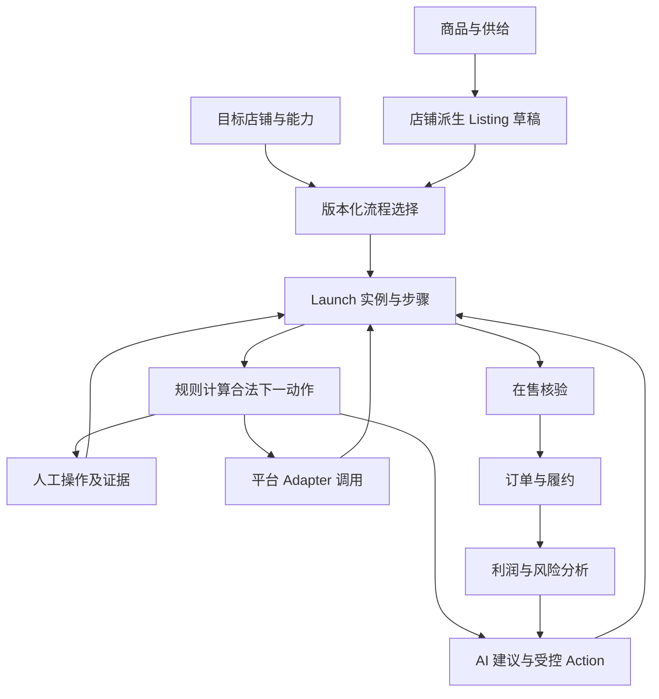

# AI 跨境电商经营平台详细策划书

> 最后更新：2026-10-14｜版本：V1.0｜状态：建设与交付策划，待按里程碑实施。
> 编制依据：现有仓库、冻结架构、阶段进度、前端整改计划及用户反馈。不包含外部市场调查，不将市场规模、收入、成本或平台授权情况作为已知事实。
> 配套成果：[开发总结（2026-10-14）](archive/DEVELOPMENT_SUMMARY_2026-10-14.md)、[前端整改计划 R2](UI_REFACTOR_BLUEPRINT.md)。

## 1. 项目决策摘要

本项目建设面向个人跨境经营者、中小运营团队和工厂协作者的经营平台。核心价值是把商品、供给、销售渠道、平台上线、履约、利润及 AI 建议连接成用户可以持续完成的工作流程。

目前已积累业务模块、权限基础、Action 执行机制、Launch 框架和 V9 前端。下一阶段应集中完成两件事：让前端正确承接已有能力；补齐复杂上线流程所需的领域动作。暂不以扩大平台数量、增加菜单或升级技术框架为主要目标。

产品主线：

> 找到或录入商品 → 明确供给和成本 → 选择店铺 → 按平台流程准备上线 → 处理审核/人工事项 → 核验在售 → 履约与经营监控 → 基于证据优化。

成功标准是用户能够完成任务，并理解状态和风险；不是页面数、Agent 数、API 数或生成文案数量。

## 2. 业务问题与价值主张

| 当前经营问题 | 产品应解决的具体问题 | 用户获得的结果 |
|---|---|---|
| 不同平台的上线要求不同 | 根据平台、市场、店铺和商品条件匹配版本化流程 | 不必靠记忆操作各平台后台 |
| 商品资料、素材、合规、价格散落 | 以商品与目标店铺为上下文聚合信息 | 减少重复填写和跨页寻找 |
| 发布成功被误认为已在售 | 分开表达内部执行、平台状态和核验可信度 | 知道商品到底提交了、审核中还是已经核验在售 |
| 价格看起来有利润，实际费用不完整 | 统一成本口径，标注估算与数据缺口 | 决策可追溯，不盲目接受平台核价 |
| AI 建议与实际操作脱节 | 将建议映射到合法 Action，并展示审批及执行结果 | 能判断 AI 做了什么、还需要谁处理 |
| 一个人与专业团队需要的信息不同 | 同一页面按经验和职责调整信息密度 | 新手不被术语淹没，专业人员不丢细节 |
| 多店和多人协作容易混淆范围 | 持续显示 Workspace、Store Scope、负责人和对象 | 减少误操作并维护数据隔离 |

本策划不承诺替用户获得平台资格、认证、图片使用权或供应商履约保证。平台只管理已有事实、可执行操作和必要的人工协作。

## 3. 用户定位与首发范围

### 3.1 用户与场景

| 用户 | 首要任务 | 默认入口 | 关键限制 |
|---|---|---|---|
| 个人新手 | 完成第一个商品的准备与上线 | 工作台、引导式 Launch | 不强迫理解内部对象或技术状态 |
| 专业运营 | 多商品、多店筛选和批量准备 | 商品库、上线中心、待办 | 批量操作仍逐店检查条件与权限 |
| Owner/负责人 | 决策、审批、利润和风险 | 经营工作台、行动中心 | 批准不等于执行成功 |
| 合规人员 | 审核材料和证据 | 合规队列、受限步骤详情 | 不默认获得经营写入与财务权限 |
| 工厂协作者 | 供给、产能、备货和实物材料 | 独立工厂门户 | 仅相关工厂对象与步骤 |
| 平台管理员 | 空间、授权、能力和审计 | 独立平台控制台 | 与商家经营空间隔离 |

### 3.2 首发业务边界

优先验证“已有商品/供给的用户完成上线”，再扩展市场机会驱动的选品路径。原因是该路径可直接利用现有商品、店铺和 Launch 基础，验证业务价值所需外部变量较少。

首批试用范围需在开始真实平台验收前确认：目标市场、类目、店铺类型、经营模式、授权账号、运营负责人及供应链条件。没有这些条件时先完成隔离环境的简单/复杂 Profile 合同测试，不随意指定平台承诺交付。

### 3.3 不纳入当前首发承诺

- 任意平台、任意类目均可自动上线。
- 无人工介入的全自动核价、认证、备货或退款。
- 全功能物流、支付、会计记账替代系统。
- 未核实的数据源所支持的实时市场预测。
- 多副本分布式部署、复杂基础设施或第三套前端。

## 4. 产品结构与业务主链

冻结关系保持：User → Workspace → Capability → Supply → Product → Sales Channel / Store → Listing → Order → Finance → AI Operations。

平台生命周期作为其上的编排层：

三个执行边界：Workflow 管真实状态；Adapter 管外部协议；Agent 管分析和建议。没有外部 API 的步骤仍保留为人工或外部任务，不删除步骤，也不伪装自动完成。

## 5. 功能策划与现有资产复用

| 域 | 产品设计 | 复用现有资产 | 待建设/验收重点 |
|---|---|---|---|
| 经营工作台 | 当前阶段、待办、风险、经营摘要、下一动作 | workbench 增量、BI、Launch、Action、告警 | 聚合契约、工作区未提交代码收口、计数与明细一致 |
| 市场与选品 | 机会事实、候选比较、货源验证、转商品 | Discovery、评分、候选相关页面 | 区分内置/导入/真实来源；保留来源与证据 |
| 商品中心 | 主档、供给、渠道、上线、表现、材料、历史 | Product、报价、Listing、商品表现 | V9 详情整合与字段正确承接 |
| 供给采购 | 供应商/工厂、报价、采购、收货、备货关联 | Supplier、Factory、Purchase、Inventory | 库存、平台备货与采购职责分离 |
| 渠道店铺 | 授权、市场、经营方式、能力与健康 | Shop、Store Scope、Adapter metadata | 能力逐操作判断、授权失效与同步异常处理 |
| Launch Center | 创建、阶段、阻断、人工协作、下一动作、审计 | Profile、Run、Step、Event、NBA、API | 核价/合规/备货/标签/证据领域动作接通 |
| 素材与合规 | 权利、版本、市场资料、证书和标签依据 | ProductAsset、ComplianceReport、ProductComplianceEvidence | 上传/内容校验、市场 Artifact、标签包版本 |
| Listing 与发布 | 目标店铺派生稿、审批、执行和回执 | Listing、AiAction、PublishAttempt | 发布不等于在售；保留专业入口与流程上下文 |
| 订单与服务 | 履约优先级、采购关联、售后和结算 | Order、Purchase、Refund、Settlement | 物流/退款记录与真实外部执行分开 |
| 财务与经营 | 到岸成本、单位经济性、实际利润、差异追溯 | costing、commercial_analytics、跨境成本域 | 数据缺失、币种、汇率、估算和实际口径 |
| AI 与自动化 | 建议、依据、Action 审批、执行、结果反馈 | Orchestrator、Tools、Action、知识和旧 Workflow | 完成 Agent 写路径迁移与任务/Trace 能力 |
| 平台服务 | 空间、成员、能力、审计、配置 | Workspace Context、管理路由、三空间外壳 | 当前部署状态、角色回归与维护入口收口 |

## 6. Launch 领域详细要求

### 6.1 定义与实例

按 platform、market、store_type、business_mode、category 等条件选择定义。发布定义不可变，新规则创建新版本，运行实例保留快照。每个商品与店铺的进度独立，历史轮次可回看。

复用 WorkflowTemplate/Run/Step，保持旧自动化与 PLATFORM_LAUNCH 类型隔离；不得让旧调度器领取 Launch 实例。状态修改通过受控动作和事务收敛，不由浏览器勾选“完成”或 Agent 直接改库。

### 6.2 核价与利润决策

保存申报价、平台核价、币种、内部安全价、成本快照、利润/利润率、可信度、决定、原因、轮次与时间。动作包括接受、重报、拒绝、放弃。

调用既有单位经济性服务；采购、物流、费用、广告、退款、税费和汇率按可用事实计算。缺失成本应显式降低可信度或阻断，不能以零替代未知值。高风险报价不可通过 AI 建议绕过 Guardrail。

### 6.3 备货与履约准备

独立表达申请/批准/准备数量、仓库、模式、计划日期、状态和外部引用。关联既有采购和库存事实；首单在不同平台可能是备货任务，不直接伪造成销售订单。

### 6.4 市场合规、标签和实物证据

基于商品、市场、类目和平台检查制造商、责任人、证书、照片、标签、条码、声明等材料。明确有效期、版本和审核依据。已有通用合规报告不能直接替代市场要求的证据。

标签包引用真实商品与合规数据，保存材料版本；认证标志必须有证据支持。实物贴标、拍摄和外部认证作为人工任务，保存提交、驳回和补交记录。

### 6.5 状态同步和可靠性

当前 refresh 接口主要刷新内部事实；后续外部同步按平台能力选择 webhook、polling 或人工回报。必须明确“本地刷新时间”和“外部事实获得时间”。

同步验证事件来源与店铺范围，保存 raw_status 与映射版本，处理重放、乱序、重试和超时。WorkflowEvent 持久化不等于事件已可靠投递；订阅、重试、失败告警和恢复须单独验收。

### 6.6 两套验证 Profile

- 简单样本：资料准备→合规→提交→在售核验→监控。
- 复杂样本：资料/属性→创建/提交→核价/决定→首单或备货→市场合规→标签→实物证据→在售核验→监控，允许合理并行。

样本用于通用框架测试，不代表 Temu 或其他平台已接通。完整验收必须覆盖低价、缺材料、版本不变、双店隔离、外部等待和失败恢复。

## 7. 前端策划与体验原则

以 frontend-v9 为唯一整改基底，旧 frontend 作为迁移对照和回退。沿用三产品空间及已有业务域能力，避免再造平行页面系统；业务域数量不要求等于日常导航入口数量。

编制期间出现并行 R3 文档：`docs/FRONTEND_R3_PAGE_OWNERSHIP_MATRIX.md` 提出“我的生意/我的商品/我的订单/我的收益/全部工具”的 4+1 入口，`docs/FRONTEND_R3_BACKEND_CAPABILITY_MAP.md` 映射后端能力。两者当前未提交，本文仅核对其开头范围声明，未验收其全量内容。该导航方案与 R2 保留八域主导航的建议存在差异，应在 M0 由前端负责人统一为一份生效方案；本策划不要求恢复八域侧栏，也不把 R3 文档自标冻结视为已经实施完成。

| 页面 | 首要问题 | 设计交付 |
|---|---|---|
| 工作台 | 现在最值得处理什么 | 优先任务、阶段入口、少量经营信号；图表次级 |
| 我的待办 | 哪些由我做、哪些等待别人 | 统一明细、负责人、期限、原因、直达操作 |
| 商品详情 | 这个商品经营得怎样、还缺什么 | 多店渠道进度、供给/成本/材料与下一动作 |
| 上线详情 | 当前阶段怎么完成 | 阶段导航、任务、材料、证据、合法动作、反馈 |
| 专业页面 | 完成特定领域工作 | 保留专业能力，携带对象上下文并返回原步骤 |
| AI 行动中心 | 建议是否可信、是否已执行 | 建议/依据/风险/审批/执行/结果分开 |

引导模式突出当前操作和等待原因；专业模式展开费用、外部状态、版本、审计等信息。两种模式使用相同事实和权限，不能成为两套业务逻辑。

优先修复已发现的渠道 DTO、素材参数/字段、权限和错误吞没问题，再重组布局。详细页面规格、组件、异常状态、分工和可用性指标见 [R2 蓝图](UI_REFACTOR_BLUEPRINT.md)。

## 8. AI 产品策略

遵循冻结的八类领域能力：市场、供给、商品、Listing、渠道策略、经营优化、财务分析、风险合规。该清单是目标职责划分，不将现有 Agent 文件数量当作全部完成。

合法路径：可信 Workspace Context → Orchestrator/Planner → 领域能力 → 建议或产物 → Policy/Permission/Risk/Approval → Executor → 业务服务 → 结果与审计。

近期优先：清理剩余 Agent 写路径；对建议展示事实来源和影响对象；让 Action 的批准、执行、不确定与失败可被用户理解。然后推进异步任务图、完整追踪和受控记忆。不得以聊天界面覆盖所有功能，也不把 LLM 自由文本当作合法动作目录。

规则模式与 LLM 模式分别标注。无模型配置时如有规则能力可降级，但不宣称具有同等生成与推理能力。

## 9. 平台与数据策略

适配器名称、能力布尔值、协议实现、账号授权、真实环境验收是不同维度。对用户展示时必须合并店铺范围、市场条件和实际验证状态。

当前源码元数据中：1688/Shopee 为 partial；TikTok/eBay/Lazada/Walmart 为 protocol_ready_unverified；Temu/SHEIN 为 restricted；Amazon 等规划适配器为 planned。这是仓库声明，不是本次对官方能力的外部核查。

真实接入优先级由目标用户现有授权和业务价值确定，不以平台热度臆定。首批每个目标组合都要形成：授权证据、API 范围、市场/类目条件、人工步骤、速率限制、失败处理及实测记录。

所有页面保持数据来源标签：真实接口、人工登记、规则推断、估算、演示/合同测试、未知。来源与核验可信度分开；人工输入可用不等于官方核验。

## 10. 数据、权限与技术架构

- 后端继续 FastAPI、SQLAlchemy、Pydantic、Alembic；前端继续 Vue/Vite/Element Plus。
- Workspace 为经营上下文，tenant 仍承接当前存储边界；复用现有映射，不再建立同义身份体系。
- 服务端校验 Membership、Permission、Data Scope 与 Store Scope；分页和统计前过滤范围，执行前重新验证撤权。
- 通用领域增量先判断现有模型能否承担；需要新增时走 Alembic，含回滚和数据保护。已有迁移不重写。
- 平台副作用保留幂等键、版本冲突控制、外部意图与回执；结果不确定时先核查，不盲目重发。
- 文件使用受控上传/存储或已验证引用，管理权利和版本；不将图片加工当作取得版权。
- 生产能力按真实负载逐步补齐队列、多副本调度和数据库验证，不因策划书出现新技术名就启动基础设施重建。

## 11. 建设路线与里程碑

| 里程碑 | 主要工作 | 依赖 | 可验收成果 | 放行标准 |
|---|---|---|---|---|
| M0 统一事实 | 工作区归属、现有能力/接口/页面清单、文档漂移、产物身份 | 当前仓库 | 一份可追踪交付台账 | 未提交与已提交分开；无过期“未开发”结论 |
| M1 可用前端主线 | R2 的契约修复、工作台/商品/待办/Launch 重组 | M0 | 用户可试用的一条真实本地链路 | 不丢上下文、不显示假空态、权限正确 |
| M2 复杂生命周期 | 核价、备货、Artifact、标签、实物材料及事实接入 | 领域模型/契约明确 | 简单与复杂样本完整执行 | 低价/缺材料阻断；版本与双店进度正确 |
| M3 可靠协同 | 外部状态映射、同步、事件投递、通知、恢复 | M2；平台能力边界 | 重复/乱序/超时可恢复 | 不重复外部副作用，人工节点可追踪 |
| M4 经营与 AI 闭环 | 订单/售后/利润贯通，Agent 写路径与 Action 结果 | M1，可与 M2/M3 按模块推进 | 风险发现到处理及效果回看 | 指标可追溯，建议不越权执行 |
| M5 试点交付 | 指定账号/市场联调、端到端、迁移副本、浏览器体验、构建与回退 | 相应目标能力完成 | 限定范围试点版本 | 清楚列出支持范围与未接能力，用户任务验收通过 |

不在人员、平台授权和范围未确认前给固定上线日期。先拆工作包并估算，再由关键依赖决定排期。每个里程碑都展示用户可操作成果，不用全站页面同时开工替代收口。

## 12. 可分派工作包

| ID | 工作包 | 主责 | 验收要点 |
|---|---|---|---|
| P01 | 代码/文档/入口/未提交工作统一登记 | 技术负责人 | 版本、归属、依赖和下一步完整 |
| P02 | V9 API 与 ViewModel 修复 | 前端+后端 | 真实响应契约、权限、失败态和分页 |
| P03 | 工作台/任务/商品/Launch 主旅程 | 产品+前端+QA | 用户不靠口头提示完成核心任务 |
| P04 | Price Review 与成本快照 | 定价领域后端 | 轮次、成本来源、低价阻断和人工决定 |
| P05 | Stock Preparation 与采购库存关联 | 供应链后端 | 数量边界、单据归属、工厂范围 |
| P06 | 市场 Artifact 与有效期规则 | 合规领域后端 | 同商品多市场差异、失效重新阻断 |
| P07 | 素材上传/权利/标签/实物证据 | 后端+前端 | 文件真实性边界、版本及认证来源 |
| P08 | 外部状态、Outbox、通知与恢复 | 平台/流程后端 | 来源校验、幂等、乱序和失败恢复 |
| P09 | Agent OS 剩余迁移 | AI 架构负责人 | 消除剩余越界写，受控执行与追踪 |
| P10 | 订单/售后/利润关联体验 | 领域前端+后端 | 从异常追到事实与处理结果 |
| P11 | 自动化浏览器与角色验收 | QA | 核心路径、异常路径和隔离用例 |
| P12 | CI、V9 镜像、切换与回退 | 发布负责人 | 验收产物一致、旧链接可用、回退可演练 |

接口、路由、权限、共享组件由指定负责人管理；业务包按对象分工，避免多人同时修改公共契约。所有任务附“成功条件、错误路径、可回退范围、测试证据”，不以“优化某模块”派工。

## 13. 质量与验收体系

### 13.1 四层证据

1. 代码证据：实现、字段、权限、状态与迁移真实存在。
2. 自动化证据：单元、契约、并发、迁移及回归测试。
3. 系统证据：隔离后端+真实浏览器+构建产物的用户操作。
4. 业务证据：限定授权店铺/市场/类目的外部结果与用户可用性。

通过前一层不自动通过后一层；历史记录不替代当前版本复测。

### 13.2 核心验收矩阵

| 场景 | 应看到的结果 |
|---|---|
| 新用户准备上线 | 清楚缺资料和下一步，未配置能力有合理入口 |
| 同商品双店 | 独立流程、独立回执、独立历史 |
| 平台报价不安全 | 成本依据可见，禁止自动接受 |
| 材料缺失/过期 | 相应节点阻断，显示补齐入口 |
| 标签依据不足 | 无法用虚构认证推进 |
| 平台等待 | 与失败区分，不要求用户无意义重试 |
| 流程版本升级 | 旧实例保留原语义 |
| 撤权/空间切换 | 旧页面数据和执行权限不延续 |
| 请求超时/重放 | 不确定结果先核查，不重复提交 |
| 前端接口失败 | 展示错误或部分数据，不伪装为无记录 |
| 经营利润异常 | 可追溯到订单、成本或费用缺口 |
| 发布与部署 | 正式产物身份匹配验收版本，具备回退 |

### 13.3 可用性与业务指标

下表为拟建指标，不是现有测量结果。采集前定义脱敏、对象范围和时间窗。

| 指标 | 定义 | 用途 |
|---|---|---|
| 首次有效上线准备率 | 新 Workspace 在约定窗口内创建合法 Launch 的比例 | 判断引导是否有效；与真实在售率分开 |
| 任务独立完成率 | 不接受操作提示而完成指定任务的人次/有效测试人次 | 验证好用；目标和样本见 R2 |
| 有效操作耗时 | 用户实际处理时间，单列平台等待时间 | 避免把平台审核延迟算成界面问题 |
| 阻断恢复率 | 已补齐且解除阻断实例数/可由用户处理的阻断实例数 | 验证材料与返回链路 |
| 上线周期 | 实例启动到核验在售的时间，按平台/市场分组 | 不能混算不同生命周期 |
| AI 采纳与执行成功率 | 合法建议被采纳比例，以及采纳后成功执行比例 | 不能以建议数代替价值 |
| 数据完整度 | 关键利润/合规字段有来源且有效的覆盖比例 | 控制不可靠决策 |
| 同步新鲜度与失败率 | 外部事实获取延迟、失败次数及恢复时间 | 本地 refresh 不冒充外部更新 |

## 14. 试点、商业化与资源规划

建议先做限定范围试点：具备真实供给和店铺的运营者、新手、协作审核人员分别验证不同旅程。首次试用先看准备上线与处理待办，之后再评估长期经营收益。

商业化可评估按 Workspace 订阅、成员/店铺/使用额度分层、AI 用量计费或实施服务，但这些均为待验证选项，不代表已具备完整计费系统。定价前需要统计实际模型、存储、同步、运维、客服及平台审核成本，并验证用户愿意付费的任务。

预算采用工作包估算：人力投入 + 测试/运行环境 + 模型调用 + 存储带宽 + 必要外部服务。没有报价和团队信息，不填虚构预算或收益预测。

开始试点前需确认：目标用户与市场、可用授权账号、负责人、每周投入、部署环境、数据保留要求及不可延迟的业务日期。这些不阻碍当前代码整理和内部体验整改，但会决定真实外部交付范围。

## 15. 风险、边界与处置

| 风险 | 影响 | 处置 |
|---|---|---|
| 前后端契约漂移 | 页面看似完成，实际请求失败 | 真实响应契约测试+浏览器写操作验收 |
| 文档完成度过于乐观 | 错误排期和外部承诺 | 分开源码、提交、历史验收、当前实测 |
| 领域动作尚未接通 | 复杂 Profile 卡在关键阶段 | 按 P04—P08补齐，不用前端勾选绕过 |
| 平台资格/能力受限 | 无法按原计划联调 | 先明确能力，保留人工步骤与范围声明 |
| 数据缺失或未核验 | 价格、合规和标签决策不可信 | 显示未知、限制自动化、保留来源与版本 |
| 多人修改共享文件 | 合并冲突、契约分叉 | 指定公共文件负责人、固定工作包边界 |
| 双前端/CI/镜像不一致 | 用户看到旧版本或未测试版本 | 统一主基底并验证实际构建产物 |
| 主库与测试混用 | 污染或损坏业务数据 | 隔离库验证，迁移前备份和只读预检 |
| Agent 迁移未结束 | 状态与审计绕过受控路径 | 按冻结架构收口写路径与 Runtime |

## 16. 文档治理与交付要求

本文件负责产品目标、范围、工作包和验收，不替代接口契约或架构 ADR。架构变更仍记入 `docs/DECISIONS.md`；接口变更更新 `docs/CONTRACT.md`；前端工程进度保持在 `docs/FRONTEND_V9_PROGRESS.md`；Launch 进度保持在 `docs/PLATFORM_WORKFLOW_PROGRESS.md`。

每批交付包括：可访问版本、实际完成任务、支持范围、验证证据、未完成项、回退办法。策划书持续维护；本次开发总结作为带日期快照归档，后续总结不得覆写历史结论。

### 主要依据

- `docs/AI_AGENT_OPERATING_SYSTEM_ARCHITECTURE.md`：Agent OS 冻结目标与迁移进度。
- `docs/PLATFORM_COMMERCE_WORKFLOW_ARCHITECTURE.md`、`docs/PLATFORM_WORKFLOW_STATE_MODEL.md`：平台生命周期架构与状态。
- `docs/PLATFORM_WORKFLOW_PROGRESS.md`：已完成机制及未接通领域边界。
- `docs/FRONTEND_V9_PROGRESS.md`、`docs/UI_REFACTOR_BLUEPRINT.md`：前端实现记录与体验整改。
- `backend/app/workflows/launch_facts.py`、`backend/app/routers/launch.py`：事实与同步当前边界。
- `backend/app/services/adapters/registry.py`、`backend/app/services/adapters/planned.py`：平台能力声明。
- `docs/CODE_AND_DIRECTORY_STANDARD.md`：代码、迁移、测试和文档规则。
